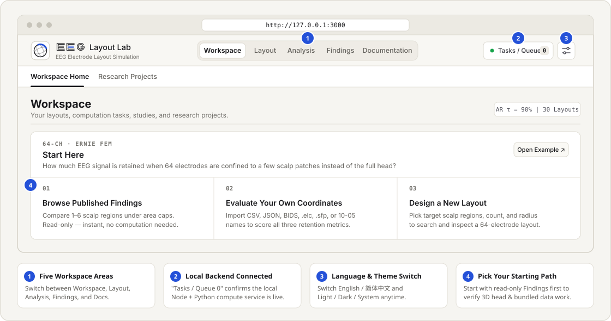

# EEGLayoutLab

EEGLayoutLab is an open-source web application for designing and comparing EEG electrode layouts. It brings together an interactive 3D head model, layout design, electrode editing, signal simulation, and reproducible result exports.

It is built for layouts confined to parts of the scalp, such as the forehead, the area around the ears or other low-hair areas. Each layout is scored relative to the 64-electrode BioSemi whole-head layout on a finite-element head model, and its record keeps the head, source and noise models behind every score.

EEGLayoutLab is developed on a non-profit basis and provided free of charge. Its original source code and accompanying documentation are licensed under GPL-3.0-only.

**Try it online:** a read-only preview runs at [eeglayout.org](https://eeglayout.org), with this documentation at [eeglayout.org/docs](https://eeglayout.org/docs/).

[简体中文指南](docs/getting-started.zh-CN.md) · [Installation manual](docs/installation.md) · [User manual](docs/user-manual.md) · [中文使用手册](docs/user-manual.zh-CN.md) · [Source setup](docs/source-installation.md) · [Model and metrics](docs/model-and-metrics.md) · [References](docs/references.md) · [Command line](docs/command-line.md) · [Architecture](docs/architecture.md) · [Changelog](CHANGELOG.md)

## Features

- **Find layouts:** the layout list has one row per layout with its retention scores, and ranks the layouts of one evaluation condition by Pareto dominance over chosen objectives. Each layout has its own page: every evaluation of its coordinates, the 3D head and coordinate table, its edited copies and signal experiments.
- **Design and edit:** search for regional layouts, move or disable electrodes of a saved layout, and evaluate imported coordinates registered to the Ernie head model. Electrode names are kept, and each input point, evaluated point and projection distance can be inspected.
- **Compare layouts:** choose a layout and then one of its evaluations on each side, set shared or independent retention requirements, and read a short conclusion beside the recorded metrics.
- **Test the model's assumptions:** evaluate a layout under optional noise models, a mismatched skull conductivity or another head model ([model](docs/model-and-metrics.md#model-mismatch-and-other-heads)). Score it, beside standard64, after electrode dropout, unequal contact noise and cap re-placement ([model](docs/model-and-metrics.md#cross-session-robustness)).
- **Use recorded EEG:** summarize EDF, BDF, BrainVision or EEGLAB recordings as channel covariances, fit a regional source prior and noise model to them with a leave-one-out check, and search or evaluate layouts under that prior. From the same summaries, choose channel subsets that best reconstruct the full recording, compared with 10-20 and random subsets, and plot their error against subset size ([model](docs/model-and-metrics.md#data-derived-source-prior), [command line](docs/command-line.md)).
- **Simulate signals:** choose source locations, waveforms and interference conditions; inspect the resulting signals, switch channels and replay the saved experiment.
- **Keep research projects:** save complete layout, editing and signal snapshots with notes and comparison settings in your workspace, and reopen them from its project list.
- **Repeat evaluations:** run studies of explicit localization-noise seeds, candidate-grid offsets or other heads, preserve every case outcome, and inspect case-level empirical summaries. The [study protocol](docs/robustness-studies.md) records how these batches reuse the original calculations.
- **Export and review:** download coordinates, original scientific JSON, reports and project delivery packages with checksums and recorded model/runtime identities. Open a delivery package in the browser to inspect its archived coordinates, scores and waveforms without the project it came from.
- **Read the method:** the documentation defines the model, metrics and validation scope. The [reference list](docs/references.md) gives the full citation of every work the method and interface draw on, grouped by topic, with what each supports and where it sets limits.

The interface supports English and Simplified Chinese. A local Python service, `eeglayoutlab serve`, runs it for one workspace: it runs the Python/SimNIBS workers, reuses exact completed results and keeps a persistent computation queue. Shared viewer resources and validated forward-field reuse reduce repeated loading and calculation.

## Run locally

For regular use on **Apple Silicon macOS** or **Linux x86_64**, install `eeglayoutlab` into a user-writable Conda environment (bundling the pre-built web interface and numerical runtime without Node.js) and launch in three commands ([installation guide](docs/installation.md)):

```sh
conda create -y -n eeglayoutlab -c conda-forge eeglayoutlab
conda activate eeglayoutlab
eeglayoutlab quickstart
```

`eeglayoutlab quickstart` downloads, SHA-256-verifies and links the default model data (`base` + `scalp-node-table`, 1.80 GB) on first run, creates `~/eeglayoutlab-workspace`, and opens the browser; run `eeglayoutlab doctor --smoke` anytime to verify your setup with a real calculation.

For development or direct SimNIBS finite-element solves (`source-reception/2`), run the one-command source setup from a checkout ([source installation guide](docs/source-installation.md); requires any system `python3 >= 3.9`, Conda/Miniforge/micromamba, and **Node.js 22.18.0 or newer**):

```sh
python3 scripts/setup_local.py --smoke           # downloads & verifies base data, builds .runtime, .venv and webapp/
.venv/bin/eeglayoutlab quickstart                # opens ~/eeglayoutlab-workspace in your browser
```

`eeglayoutlab serve` runs the application for one **workspace**, a directory of your choice (the current directory if you name none) that keeps your task list, electrode names, robustness studies and research projects. Calculation results stay in the scientific root's `results/v2` (`$CONDA_PREFIX/share/eeglayoutlab/root/results/v2` in a Conda install, or the checkout's `results/v2` in a source setup), shared by every workspace, using either the installed Conda Python environment or the checkout's `.runtime` scientific runtime. The service listens on a free port of `127.0.0.1` and opens the application in your browser once it answers; keep the terminal running and press **Control + C** to stop it. Each start has a new address and session: a tab left from an earlier run asks you to run the command again, and running the command while the service runs opens the running instance. `--no-browser` prints the address instead, `--cache-only` serves stored results without computing, and [CONTRIBUTING](CONTRIBUTING.md#the-local-service) describes the other options. To verify the scientific runtime and model data end to end, run `eeglayoutlab doctor --smoke` (or `.venv/bin/eeglayoutlab examples run --skip-cross-head` in a source checkout). When the page opens, confirm the **Tasks / Queue** badge in the top-right shows `0` (connected) and pick any starting card:



The service also serves the documentation site under `/docs/` once it has been built with MkDocs ([building the documentation](CONTRIBUTING.md#building-the-documentation)); until then, documentation links open on GitHub. For interface development, `npm run dev` in `webapp/` forwards its API requests to a running service ([CONTRIBUTING](CONTRIBUTING.md#interface-development)).

The earlier Node host (`npm start` in `webapp/`) is kept as a legacy host until phase 4 of [design 0001](docs/design/0001-local-first-architecture.md); hosted deployments stay at the tag `node-host-freeze`, and the current interface no longer opens that host's research projects. The projects, robustness studies and signal records it saved can be copied into a workspace with `eeglayoutlab workspace import-legacy`, which leaves the Node host's files unchanged ([CONTRIBUTING](CONTRIBUTING.md#data-from-the-node-host)).

## Model data

A fresh source installation needs the code and the matching base data bundle. The bundle contains selected frozen application inputs and example results; the full historical calculation cache is excluded.

| File | Size | Use |
| --- | --- | --- |
| [Base data bundle](https://github.com/Yiming-S/EEGLayoutLab/releases/download/v0.2.0/eeglayoutlab-data-v1.tar.gz) | 282.5 MiB | Model inputs and supplied records for the web application |
| [Bundle SHA-256 checksum](https://github.com/Yiming-S/EEGLayoutLab/releases/download/v0.2.0/eeglayoutlab-data-v1.tar.gz.sha256) | Text | Verify the data archive before installation |

Both files can be downloaded directly without authentication via `curl` or a browser. Follow the [source installation guide](docs/source-installation.md) to verify and install the data and prepare the scientific runtime, then start the application as [above](#run-locally).

## How to use

The top bar has five areas: **Workspace**, **Layout**, **Analysis**, **Findings** and **Documentation**.

1. **Start:** the **Workspace** home lists the ways to create a layout, recent layouts, computation tasks, robustness studies and research projects.
2. **Browse:** **Layout → Layout List** has one row per layout. **View layout** opens the layout's page, which lists its evaluations under each condition, nominal Ernie first, and its edited copies and signal experiments. From there, open the comparison, the position-offset test, signal simulation or a robustness study.
3. **Design:** in **Layout → Region Design**, set the region count, allowed placement range and maximum region radius, and search.
4. **Import or edit:** in **Layout → Coordinate Import**, evaluate named coordinates registered to the Ernie head model; in **Electrode Editor**, move or disable electrodes of a saved layout and evaluate the copy. The [coordinate-file interface](docs/coordinate-file-interface.md) also supports explicitly declared electrodes.tsv and coordsystem.json pairs with region metadata, in the Ernie native frame or an MNI template space, and lists of 64 10-05 electrode names. Exports can be written in either frame, or as MNE-Python (`.elc`) and EEGLAB (`.sfp`) montage files, and state that the positions are template positions with template landmarks. A 2D layout figure can be downloaded as SVG or PNG.
5. **Compare:** in **Analysis → Compare Layouts**, choose a layout and one of its evaluations on each side, judge both under the same requirements, and export coordinates, results or reproducibility bundles.
6. **Repeat:** in **Analysis → Robustness studies**, create a study from imported coordinates or a saved 64-electrode layout, list explicit seed, grid-offset or head cases, save a draft and start the batch. Opening or refreshing a study reads its saved state; a service restart requires an explicit study resume.
7. **Simulate:** in **Analysis → Signal Simulation**, choose a layout, source locations, waveforms and interference settings.
8. **Use recorded EEG:** summarize recordings with `eeg-summary` and fit a prior with `prior` on the [command line](docs/command-line.md). Load the prior on **Region Design** or **Coordinate Import** in place of a noise model. Load the summaries on **Analysis → Channel Subsets** to choose channel subsets in the browser.
9. **Read the results and the method:** **Findings** holds the total-area study and the two historical batches, each with its protocol and date. **Documentation** has the user guide; its **Models & Methods** page links to the chapters on the [model and metrics](docs/model-and-metrics.md), [method details](docs/method-details.md), [historical studies](docs/historical-studies.md), [validation](docs/validation.md) and [references](docs/references.md).

The [command line](docs/command-line.md) runs the same evaluations, searches and robustness studies without the browser, with the same request checks and scientific identity. [`examples/`](examples/README.md) holds three reproducible examples with expected scores.

Use **Research Projects** to keep selected layouts, edited copies, signal experiments, notes and comparison requirements together. The page lists the projects of the workspace; each one is kept in the workspace directory, under `projects/`, and needs no access key. Saved project snapshots remain available independently of the computation queue and of the original records.

The project delivery download includes exact archived scientific JSON files, checksums, a readable report, saved comparison settings and recorded model/runtime identities. Large model payloads are referenced by their manifests. Choose **Open a local delivery package** in Research Projects, or visit `/deliveries`, to read the saved package in a browser. The original project and task APIs are not required; application and display assets must remain accessible.

Use the upper-right language control to switch between English and Simplified Chinese. **Minimum Required Retention** changes how existing scores are judged; it does not start a new calculation.

Layouts are designed and scored on the SimNIBS example subject Ernie; installed head packages let the same layout be evaluated on other heads. Scores depend on the recorded head model, source assumptions, noise model, and evaluation protocol. Read [Model and metrics](docs/model-and-metrics.md) for definitions and interpretation, and the [reference list](docs/references.md) for the published work behind each modelling choice and its known limits.

## Verification

Local verification covers coordinate-name round trips, per-electrode review, workspace projects and their experiment associations, local delivery viewing, scientific regression, repeated studies, task reconciliation and backup/restore. Unit tests, type checks, lint, production builds and real-browser workflows are run for each stage. The Python service was checked against the Node host it replaces: its request keys and records equal Node's on synthetic roots and, read only, on the author's installation, and every browser workflow was run against it (only `check-radius-recovery-live.mjs` awaits a refreshed fixture; all cache-only browser workflows in `browser.yml` build their own fixtures via `build-browser-fixtures.mjs`, [phase 2 results](docs/design/0001-phase-2-plan.md#phase-2-results)). GitHub Actions workflows cover fast checks (`checks.yml`), the data tier (`data.yml`), fresh Conda package verification (`package.yml`), real-Chrome browser checks (`browser.yml`) and draft release + `mike` docs staging (`release.yml`) across Linux x86_64 and macOS arm64, running on GitHub once pushed ([verification tiers](CONTRIBUTING.md#verification-tiers)).

A fresh native FEM run reproduced the qualified `128 × 4352` forward field and projected coordinates exactly. Single-source and multi-source arrays, scientific outputs and non-timing numerical quality fields matched the saved baseline. The 95 recorded scientific source, configuration, model and input files remained unchanged. Eight batch cases were also recomputed independently through the original single-case entry point, with exact scientific values and provenance; the new case-level quantiles were checked independently with NumPy.

[CONTRIBUTING.md](CONTRIBUTING.md) explains test selection and external-data requirements; the [native release gate](docs/native-release-gate.md) documents the separate new-solve check. Stopped-service task recovery is documented in [task reconciliation](docs/task-reconciliation.md).

## Deployment and operations

The application runs locally for one user. The legacy Node host, which stays frozen for hosted deployments at the tag `node-host-freeze` until phase 4 of design 0001, includes explicit scientific and queue-directory configuration, HTTPS reverse-proxy access rules, request identifiers, bounded request logs, local status probes, disk and optional Node-memory admission checks, and maintenance/drain controls. Release manifests record source, data and runtime identities; backup and restore tools preserve the Node host's scientific records and private project and study archives.

A read-only showcase of the interface (example results, the layout pages and 3D head, the comparison page and the guide; nothing is sent to a service) runs at [eeglayout.org](https://eeglayout.org) and can be built as static files; see [showcase](docs/showcase.md).

Model data is also packaged as versioned packages (base bundle, scalp-node tables, head packages) that `eeglayoutlab data` installs and verifies; see [data packages](docs/data-packages.md).

See [server configuration](docs/server-deployment.md) and [web operations](docs/web-operations.md) for the Node host's installation requirements, environment examples, monitoring and recovery procedures. The [architecture](docs/architecture.md) documents feature, viewer, task, execution and storage modules.

## Repository structure

| Directory | Contents |
| --- | --- |
| [`contracts/`](contracts/) | Shared layout types, API format documentation and cross-language examples |
| [`webapp/`](webapp/) | Feature workspaces, shared task client, modular viewer, and the legacy Node host |
| [`src/compact_eeg/`](src/compact_eeg/) | Scientific methods and computation workflows |
| [`src/eeglayoutlab/`](src/eeglayoutlab/) | The `eeglayoutlab` command: the local service (`serve`), all nine scientific CLI commands (`design`, `export`, `evaluate`, `search`, `study`, `pareto`, `eeg-summary`, `prior`, `channels`), `quickstart`, `doctor`, `examples run`, request schemas, and data-package tools |
| [`configs/`](configs/) | Scientific configuration, runtime locks and deployment environment template |
| [`packaging/`](packaging/) | `rattler-build` Conda recipes and verification scripts for `cortech` and `eeglayoutlab` |
| [`scripts/`](scripts/) | Identity-locked worker entry points, source setup, offline table/head builders, and release checks ([index](scripts/README.md)) |
| [`tests/`](tests/) | Scientific, service, CLI, and cross-language parity regression tests |
| [`.github/workflows/`](.github/workflows/) | Automated CI tiers (`checks`, `data`, `package`, `browser`, `docs`, `pages`, `release`) |
| [`docs/`](docs/) | Architecture, manuals, methods, references, data, validation, design records and deployment documentation |
| [`examples/`](examples/) | Reproducible command-line examples with expected scores |
| [`data/`](data/) | Data inventory, package release index (`packages.json`), and source attribution |

Git tracks application source, required display assets, configuration, documentation, and tests. Releases provide versioned source and data materials, checksums, and component notices. Installed environments, generated computation records, demo recordings, and local verification captures stay outside Git; historical calculation caches are not uploaded.

## Copyright and third-party material

© 2026 Yiming Shen. The project's original source code and accompanying documentation are licensed under the [GNU General Public License version 3 only (GPL-3.0-only)](LICENSE). This permits commercial use of the code; distribution of modified versions must follow the GPL, including its corresponding-source requirements.

**The data files are not under that grant.** The Ernie head-model meshes, the MNI mapping and the Ernie result records in `webapp/public/models/ernie/` and `webapp/public/data/` are derived from the SimNIBS example dataset v4.1 and remain under CC BY-NC 4.0: non-commercial use only, with attribution. The licence does not permit commercial use of those files. A `NOTICE.md` in each of the two directories lists its files and their terms.

Third-party software and data retain their own licenses. SimNIBS uses GPL-3.0-only; Ernie data and its derived scientific and display assets remain under CC BY-NC 4.0. Attribution, source links, and modification descriptions are in [THIRD_PARTY_NOTICES.md](THIRD_PARTY_NOTICES.md).

## Acknowledgments

Yi Wang, PhD
