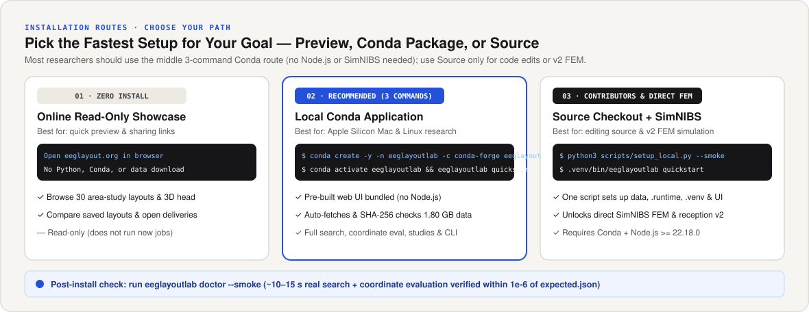
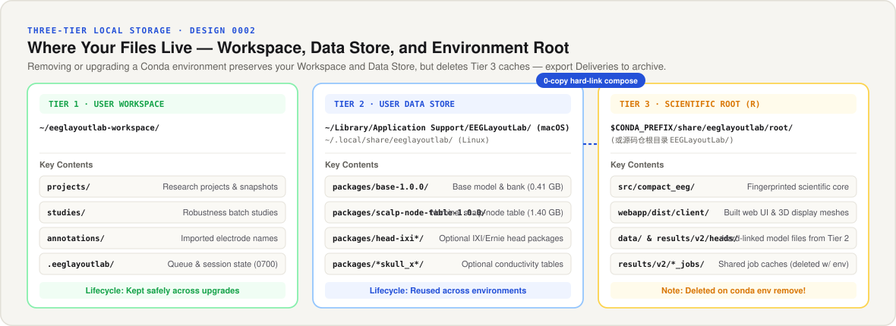

# Installation Manual

Install EEGLayoutLab into a user-writable Conda or micromamba environment to run regional layout searches, arbitrary scalp-coordinate evaluations, cross-head and skull-conductivity robustness studies, real-EEG prior fitting, and reproducible exports locally—without cloning the repository or installing Node.js.

[简体中文完整安装手册](installation.zh-CN.md) · [User Manual](user-manual.md) · [Source Installation (for Contributors & SimNIBS FEM)](source-installation.md)

> **Current distribution status:** Packaging recipes for `cortech` and `eeglayoutlab` live in [`packaging/conda-forge/`](../packaging/conda-forge/eeglayoutlab/README.md) and are rehearsed on Apple Silicon macOS and Linux x86_64. Until both feedstocks and the Zenodo data record are published on conda-forge, pass `--from MIRROR` from a locally built channel or use the one-command [source installation guide](source-installation.md).

## 1. Choose your installation route

EEGLayoutLab provides three ways to explore or run calculations depending on whether you want a zero-install preview, a regular research setup, or a full source development checkout:



| Route | Who it is for | Prerequisites | Time & disk |
| --- | --- | --- | --- |
| **1. Online Read-Only Showcase** (`eeglayout.org`) | Collaborators, reviewers, or anyone previewing existing 30-condition Pareto results, 3D head views, layout comparisons, or saved delivery packages | Any modern web browser (WebGL enabled) | Instant · `0 GB` |
| **2. Local Conda Application** *(Recommended)* | Researchers running new regional searches, evaluating custom 10-05 / BIDS / MNI / `.elc` / `.sfp` coordinates, running robustness batches, or scripting via CLI on Mac or Linux | User-writable Conda (`miniforge3`) or `micromamba` (no Node.js, no compiler, no SimNIBS required) | ~2–5 min · `~3 GB` env + `1.80 GB` default model data |
| **3. Source Checkout + SimNIBS** ([guide](source-installation.md)) | Contributors modifying code/UI, or users computing **new** single-dipole cortical signal simulations (`source-reception/2`) and building custom head meshes (`charm`) | `python3 >= 3.9`, Conda, `Node.js >= 22.18.0`, Git | ~8–15 min · `~5–8 GB` env + model data |

## 2. System and directory requirements

| Platform | Supported architecture | Minimum OS / libc | Notes |
| --- | --- | --- | --- |
| **macOS** | Apple Silicon (`osx-arm64`, M1 / M2 / M3 / M4) | macOS 14 Sonoma or newer | Use native arm64 Miniforge or micromamba (not Intel x86_64 under Rosetta) |
| **Linux** | 64-bit x86 (`linux-64`) | `glibc >= 2.28` (e.g., Ubuntu 22.04 / 24.04, Debian 12, RHEL 9) | Headless servers supported via `--no-browser` + SSH port forwarding |
| **Windows** | WSL2 (`linux-64`) | Windows 11 + WSL2 Ubuntu 24.04 | Run the Linux 3-command install inside WSL2 (native `win-64` is not yet supported) |

**User-writable environment rule (`exit 2` guard):** Always create the Conda environment under your own user account (for example `~/miniforge3/envs/eeglayoutlab`). Because EEGLayoutLab writes shared calculation caches under `$CONDA_PREFIX/share/eeglayoutlab/root/results/v2`, installing into a read-only system `/opt` or shared multi-user prefix causes `eeglayoutlab serve` and `eeglayoutlab data compose` to exit immediately with status `2` and a clear prompt to create a user environment.

## 3. Three-command installation and first launch

Open Terminal (macOS) or your shell (Linux / WSL2) and run:

```sh
conda create -y -n eeglayoutlab -c conda-forge eeglayoutlab
conda activate eeglayoutlab
eeglayoutlab quickstart
```

### What happens on first launch vs. daily launches

1. **First run (`eeglayoutlab quickstart`):**
   - Verifies that the scientific root is writable and checks which model packages are already present.
   - Displays the default download size (**`1.80 GB`** total: `base` `0.41 GB` + `scalp-node-table` `1.40 GB`), downloads with automatic HTTP `Range` resume if a connection drops, verifies every file's SHA-256 digest against [`data/packages.json`](../data/packages.json) and [`data/manifest.json`](../data/manifest.json), and hard-links the files into the environment (reusing any package previously downloaded to your user data store in under a second).
   - Initializes your personal workspace directory at `~/eeglayoutlab-workspace` (`0700` permissions) and starts `eeglayoutlab serve` on a free loopback port (`127.0.0.1:<port>`).
   - Automatically opens your default browser through a private one-time sign-in token so only your local browser session can submit tasks.
2. **Subsequent runs:**
   - Simply run `conda activate eeglayoutlab` followed by `eeglayoutlab quickstart`. Seeing that your data and workspace are already intact, it launches the browser in under a second.
   - Keep the terminal window open while working; press **Control + C** to stop the service cleanly.


When the browser opens, confirm that the **Tasks / Queue** badge in the upper-right corner shows a green indicator and `0`. You are ready to design, import, compare, or simulate layouts (see the [User Manual](user-manual.md) for a complete walkthrough).

### Useful launch flags

```sh
# Minimal 0.41 GB download (enables regional radius search & v1 signal simulation; skips 1.40 GB coordinate table)
eeglayoutlab quickstart --base-only

# Open a specific project workspace folder instead of ~/eeglayoutlab-workspace
eeglayoutlab quickstart ~/projects/ear-eeg-paper

# Run a real calculation smoke test before opening the browser
eeglayoutlab quickstart --verify

# Headless / remote SSH server: print the 127.0.0.1:<port>/open?token=... URL without launching a local browser
eeglayoutlab serve ~/eeglayoutlab-workspace --no-browser

# Read-only inspection mode: browse saved layouts, studies and projects while refusing new computations
eeglayoutlab serve ~/eeglayoutlab-workspace --cache-only
```

## 4. Verifying your installation (`doctor --smoke`) and managing model data

Checking that the web UI loads only confirms that the HTTP service is running. To verify that your **Python numerical environment, `cortech` surface projection, and model data** reproduce reference scores end to end, run:

```sh
eeglayoutlab doctor --smoke
```

In about 10–15 seconds, `doctor --smoke` inspects the scientific root, worker interpreter, installed packages, and web assets, then runs Examples 1 and 2 in an isolated temporary directory (`standard64` design, BIDS/MNE/EEGLAB/SVG exports, a 2-region search, and an independent coordinate evaluation), verifying that every numerical metric matches [`examples/expected.json`](../examples/expected.json) within `1e-6`. Run `eeglayoutlab doctor` (without `--smoke`) for an instant non-computing health check.

### In-browser missing-data guidance & hot reload

If you start with `--base-only` (or open a fresh source checkout before installing data), the web interface queries `/api/data-status` automatically and displays a bilingual readiness banner showing the exact terminal command needed for the current page (such as `eeglayoutlab data install` or `eeglayoutlab data install scalp-node-table`), with a one-click **Copy command** button. Once the terminal download finishes, click **Check data again** in the browser—no server restart is required.

### Model data package catalog (`eeglayoutlab data`)

All model packages are indexed with pinned SHA-256 digests in [`data/packages.json`](../data/packages.json) (see [data packages](data-packages.md) for build provenance):

| Package name | Download size | Required for | Install command |
| --- | --- | --- | --- |
| `base` | `0.41 GB` (21 files) | Regional radius search (`search`), electrode editor on bank vertices, v1 signal simulation, viewing saved records | Installed by default (`eeglayoutlab data install base`) |
| `scalp-node-table` | `1.40 GB` | Evaluating arbitrary / imported coordinates (`evaluate`), electrode edits off bank, robustness studies (`noise_seeds`, `grid_displacements`) without SimNIBS | Installed by default (`eeglayoutlab data install scalp-node-table`) |
| `scalp-node-table-skull_x0.5` | `1.40 GB` | Evaluating layouts under halved skull conductivity (`--conductivity skull_x0.5`) | `eeglayoutlab data install scalp-node-table-skull_x0.5` |
| `scalp-node-table-skull_x2` | `1.40 GB` | Evaluating layouts under doubled skull conductivity (`--conductivity skull_x2`) | `eeglayoutlab data install scalp-node-table-skull_x2` |
| `head-ernie_xh` + 10 `head-ixi*` | `13.34 GB` total (~1.1–1.3 GB each) | Cross-subject anatomical transfer studies (`heads` protocol & Example 3 across 11 heads) | `eeglayoutlab data install --examples` (or individual `head-ixi002`, etc.) |

Useful data management subcommands:

```sh
eeglayoutlab data list                         # show installed vs available packages and disk paths
eeglayoutlab data verify                       # re-verify SHA-256 of every installed package file
eeglayoutlab data install --from /local/mirror # install from an offline directory or institutional mirror
eeglayoutlab data remove head-ixi002           # remove an optional package from the user data store
```

*(Note: in an installed Conda environment, `eeglayoutlab data install` automatically runs `compose` to hard-link files into the scientific root; in a source checkout, append `&& .venv/bin/eeglayoutlab data compose`.)*

## 5. Conda package vs. source checkout capabilities

| Capability | Conda package (`osx-arm64` & `linux-64`) | Source checkout + SimNIBS (`osx-arm64`) |
| --- | --- | --- |
| Regional radius search (`1 <= K <= 64`), Pareto ranking & 3D head viewer | Supported (with `base`) | Supported |
| Custom coordinate import (10-05, BIDS, MNI, landmarks, `.elc`, `.sfp`) & evaluation | Supported (via `scalp-node-table`) | Supported (via table or direct FEM) |
| Electrode editor, cross-session dropout / impedance / re-placement checks | Supported | Supported |
| Skull-conductivity mismatch (`skull_x0.5`, `skull_x2`) & multi-head studies (`study`) | Supported when corresponding packages are installed | Supported |
| Recorded EEG covariance summaries (`eeg-summary`), priors (`prior`) & channel subsets (`channels`) | Supported | Supported |
| Multi-source regional signal simulation (`source-reception/1`) & viewing saved `v2` / delivery files | Supported | Supported |
| **Computing new single-dipole cortical simulations (`source-reception/2`)** | **Not available** (requires SimNIBS + MUMPS) | Supported |
| Direct per-request FEM without a precomputed table, or building new heads (`charm`) | **Not available** | Supported ([source installation](source-installation.md)) |

## 6. Where files live, upgrading, and safe uninstallation

EEGLayoutLab separates your personal work, downloaded model archives, and environment caches into three independent locations ([design 0002](design/0002-installed-scientific-root.md)):



1. **Tier 1 — Personal Workspace (`~/eeglayoutlab-workspace`)**: Holds your research projects (`projects/`), robustness studies (`studies/`), imported electrode names (`annotations/`), and local queue history (`.eeglayoutlab/`). **Preserved across upgrades and environment deletion.** Keep it on a local POSIX filesystem (`APFS`, `ext4`, `xfs`); network/FAT/exFAT mounts that ignore `chmod 0700` are refused for session security.
2. **Tier 2 — User Data Store** (`~/Library/Application Support/EEGLayoutLab` on macOS, `~/.local/share/eeglayoutlab` on Linux, or `$EEGLAYOUTLAB_DATA_DIR`): Holds verified read-only data packages. **Preserved when you remove or recreate Conda environments**, so a fresh environment re-links `1.80 GB` instantaneously without re-downloading.
3. **Tier 3 — Environment Scientific Root (`$CONDA_PREFIX/share/eeglayoutlab/root`)**: Holds the fingerprinted scientific core, pre-built web client, hard-linked model inputs, and shared job caches (`results/v2/*_jobs`). **Running `conda env remove -n eeglayoutlab` deletes all job caches inside that environment.** Before removing an environment, save key layouts, edits, and simulations to **Research Projects** and click **Download project delivery package** to keep a permanent, self-contained archive.

## 7. Troubleshooting installation and startup

| Symptom or message | Cause | Fix |
| --- | --- | --- |
| `error: scientific root ... is not writable` (`exit 2`) | Installed into a system-wide or root-owned Conda prefix | Create a user-owned environment (`conda create -y -n eeglayoutlab ...`) under your home directory |
| Browser shows `401 Unauthorized` or "Session expired — run `eeglayoutlab serve` again" | Opened `localhost:<port>` instead of `127.0.0.1:<port>`, typed a bare port without `/open?token=...`, or reused a tab from a stopped server | Run `eeglayoutlab quickstart` (or `eeglayoutlab serve ~/eeglayoutlab-workspace`) to open a fresh authenticated session tab |
| Coordinate Import says `scalp-node-table` is required | Started with `--base-only` (`0.41 GB`) on an environment without SimNIBS | Run `eeglayoutlab data install scalp-node-table` in Terminal, then click **Check data again** in the browser |
| Queue reports waiting on an interrupted worker after a system crash or power loss | Stale worker lock from an unclean OS shutdown | Confirm no Python worker is still running, then launch once with `eeglayoutlab serve ~/eeglayoutlab-workspace --clear-interrupted` |
| Workspace refused on external USB / network drive | Drive ignores POSIX `0700` permissions on `.eeglayoutlab/` | Place the workspace folder on your internal disk (e.g., `~/eeglayoutlab-workspace`) |
| Large package download interrupted on unstable Wi-Fi | Network timeout during `1.40 GB` archive transfer | Simply re-run `eeglayoutlab quickstart` or `eeglayoutlab data install`—partial `.part` downloads resume automatically via HTTP `Range` |

Next step: continue to the [Complete User Manual](user-manual.md) to learn every workflow in the web interface and command line.
