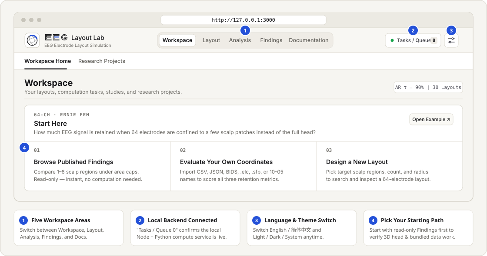

# Installation

Install EEGLayoutLab into a user-writable Conda or micromamba environment to run regional layout searches, coordinate evaluations, robustness studies and reproducible exports locally—without cloning the repository or installing Node.js.

[简体中文安装说明](installation.zh-CN.md) · [Source installation (for contributors & SimNIBS FEM)](source-installation.md)

> **Current distribution status:** Packaging recipes for `cortech` and `eeglayoutlab` live in [`packaging/conda-forge/`](../packaging/conda-forge/eeglayoutlab/README.md) and are rehearsed on Apple Silicon macOS and Linux x86_64. Until both feedstocks and the Zenodo data record are published on conda-forge, pass `--from MIRROR` from a locally built channel or use the one-command [source installation guide](source-installation.md).

## Quick start (3 commands)

```sh
conda create -y -n eeglayoutlab -c conda-forge eeglayoutlab
conda activate eeglayoutlab
eeglayoutlab quickstart
```

What `eeglayoutlab quickstart` does automatically:

1. **First run:** shows the required default model data (`base` 0.41 GB + `scalp-node-table` 1.40 GB = **1.80 GB**), downloads it with resume support, verifies every file's SHA-256 digest, links it into the environment (reusing any copy already in your user data directory without re-downloading), creates `~/eeglayoutlab-workspace`, and opens the application in your browser on `127.0.0.1`.
2. **Every subsequent run:** sees that the data and workspace are already ready and opens the browser in under a second. Keep the terminal running while working and press **Control + C** to stop.

To run an end-to-end health and real-calculation check at any time (about 10–15 seconds; verifies standard64 design, BIDS/MNE/EEGLAB/SVG export, regional search and coordinate evaluation against [`examples/expected.json`](../examples/expected.json) within `1e-6`):

```sh
eeglayoutlab doctor --smoke
```



## Supported platforms

| Platform | Architecture | Requirements |
| --- | --- | --- |
| **macOS** | Apple Silicon (`osx-arm64`, macOS 14+) | User-writable Conda (`miniforge3`) or `micromamba`; ~3 GB environment + **1.80 GB** default model data |
| **Linux** | x86_64 (`linux-64`, glibc 2.28+, e.g. Ubuntu 24.04) | User-writable Conda (`miniforge3`) or `micromamba`; ~3 GB environment + **1.80 GB** default model data |
| **Windows** | WSL2 (`linux-64`) | Install WSL2 (Ubuntu 24.04) and run the 3 Linux commands inside WSL2 (native Windows is not yet supported; WSL2 is not yet tested) |

Do **not** install into a read-only system or shared multi-user Conda prefix: `eeglayoutlab` stores computed scientific records inside `$CONDA_PREFIX/share/eeglayoutlab/root/results/v2` and refuses an unwritable root before starting (`exit 2`). Always create the environment under your own user account.

## Custom workspaces and on-demand data packages

If you prefer explicit step-by-step commands or want additional head models / conductivity scenarios ([data packages](data-packages.md)):

```sh
# Minimal data only (0.41 GB: regional radius search & signal simulation v1, without custom coordinate table)
eeglayoutlab quickstart --base-only

# Custom workspace folder or manual service launch
eeglayoutlab data install
eeglayoutlab serve /path/to/my-study-workspace

# Optional cross-head study heads (Example 3, 11 heads, 13.34 GB)
eeglayoutlab data install --examples
eeglayoutlab examples run

# Optional skull-conductivity mismatch tables (1.40 GB each)
eeglayoutlab data install scalp-node-table-skull_x0.5 scalp-node-table-skull_x2
```

## What works in the Conda package vs source installation

| Capability | Conda package (`osx-arm64` & `linux-64`) | Source installation with SimNIBS (`osx-arm64`) |
| --- | --- | --- |
| Regional radius search (`search`), Pareto ranking (`pareto`) & electrode editor | Included (with `base`) | Included |
| Evaluating imported / arbitrary scalp coordinates (`evaluate`, perturbations, robustness) | Included (via `scalp-node-table`, no FEM solve needed) | Included (via table or direct SimNIBS FEM) |
| Skull-conductivity scenarios & cross-head studies (`study`) | Included when the corresponding scenario or head packages are installed | Included |
| Recorded EEG summaries (`eeg-summary`), empirical priors (`prior`) & channel subsets (`channels`) | Included | Included |
| Signal simulation v1 (`source-reception/1`) & opening saved v2 records / project deliveries | Included | Included |
| **New signal simulation v2 (`source-reception/2`) calculations** | **Not available** (requires SimNIBS; stored v2 records remain viewable) | Included |
| Direct per-request FEM without a table, or building new head packages (`charm`) | **Not available** | Included ([source installation](source-installation.md)) |

## Where files live and removing an environment

EEGLayoutLab separates three locations ([design 0002](design/0002-installed-scientific-root.md)):

1. **Workspace (`~/eeglayoutlab-workspace`)**: your research projects (`projects/`), robustness studies (`studies/`), electrode-name annotations (`annotations/`) and task history. Safe across upgrades and environment recreation.
2. **User data store** (`~/Library/Application Support/EEGLayoutLab` on macOS, `~/.local/share/eeglayoutlab` on Linux, or `EEGLAYOUTLAB_DATA_DIR`): downloaded model packages (`packages/`). Kept when a Conda environment is removed so a new environment links them automatically on the next `eeglayoutlab quickstart` without re-downloading.
3. **Environment scientific root (`$CONDA_PREFIX/share/eeglayoutlab/root`)**: code, static interface and shared calculation caches (`results/v2/*_jobs`). **Running `conda env remove -n eeglayoutlab` deletes all calculation caches stored in that environment.** Export [project delivery packages](../contracts/project-formats.md) from **Research Projects** beforehand for any results you wish to archive permanently.
