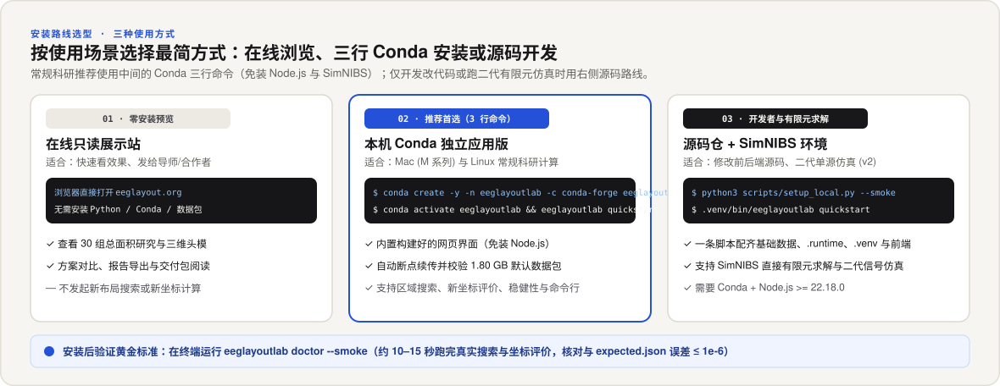
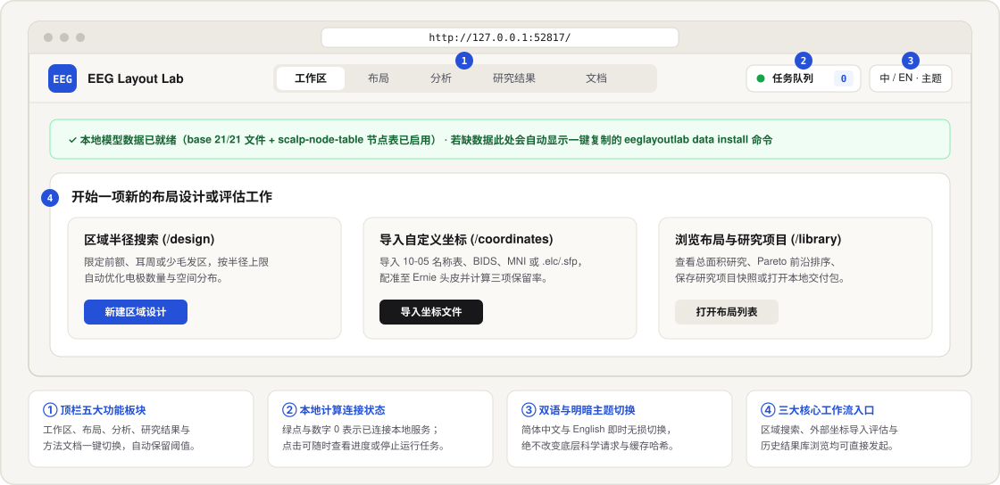
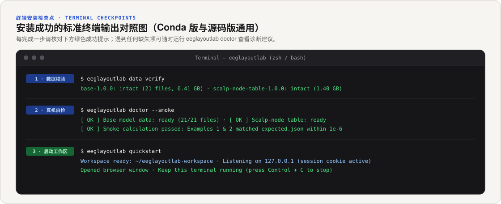
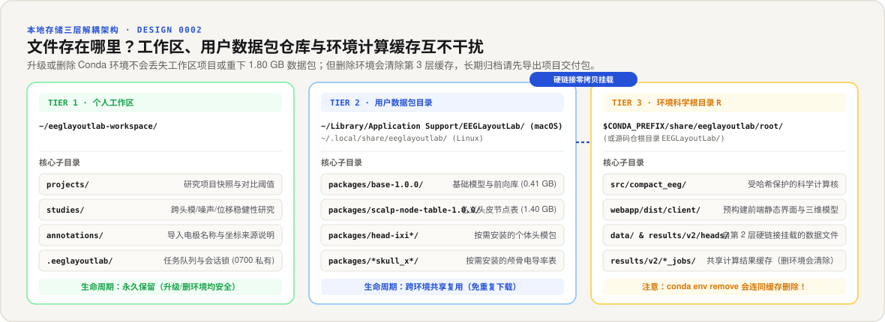

# 完整安装手册

将 EEGLayoutLab 安装到个人可写的 Conda 或 micromamba 环境中，即可在本机完成局部区域电极搜索、任意外部头皮坐标评价、跨头模与颅骨电导率失配稳健性研究、真实脑电先验拟合及可复现交付包导出——全程无需克隆源码仓库，也无需安装 Node.js 或编译工具链。

[English Installation Manual](installation.md) · [完整使用手册（图文版）](user-manual.zh-CN.md) · [源码安装说明（面向开发者与 SimNIBS 有限元求解）](source-installation.zh-CN.md)

> **当前分发状态：** `cortech` 与 `eeglayoutlab` 的 Conda 打包配方位于 [`packaging/conda-forge/`](../packaging/conda-forge/eeglayoutlab/README.md)，已在 Apple Silicon macOS 与 Linux x86_64 上完成全流程预演。在两个包正式合入 conda-forge 且 Zenodo 数据记录公开前，可通过本地通道配合 `--from MIRROR` 启动，或使用一行脚本自动配齐环境的[源码安装说明](source-installation.zh-CN.md)。

## 1. 选择适合你的使用与安装路线

根据你是想「零安装快速看效果」、「在本机开展常规脑电布局研究」，还是「修改源码或运行二代单偶极子有限元仿真」，可按需选择以下三条路线：



| 路线 | 适用人群与场景 | 前置软件要求 | 预计耗时与空间 |
| --- | --- | --- | --- |
| **1. 在线只读展示站**（`eeglayout.org`） | 导师、合作者或审稿人快速查看 30 组总面积研究布局、三维头模、方案对比与离线交付包 | 任意支持 WebGL 的现代浏览器 | 即开即用 · `0 GB` |
| **2. 本机 Conda 独立应用版**（**推荐首选**） | 在 Mac 或 Linux 上运行新区域搜索、评估导入的 10-05 / BIDS / MNI / `.elc` / `.sfp` 坐标、跑稳健性批处理或命令行脚本的研究者 | 个人目录下的 Conda（推荐 `miniforge3`）或 `micromamba`（**无需** Node.js、编译器或 SimNIBS） | 约 2–5 分钟 · 环境约 `3 GB` + 默认数据 `1.80 GB` |
| **3. 源码仓 + SimNIBS 环境**（[说明](source-installation.zh-CN.md)） | 修改前后端源码的贡献者，或需要**新计算**二代单源皮层信号仿真（`source-reception/2`）及构建新头模（`charm`）的用户 | `python3 >= 3.9`、Conda、`Node.js >= 22.18.0`、Git | 约 8–15 分钟 · 环境约 `5–8 GB` + 模型数据 |

## 2. 操作系统与目录权限要求

| 操作系统 | 支持的硬件架构 | 最低系统版本 | 备注说明 |
| --- | --- | --- | --- |
| **macOS** | Apple Silicon（M1 / M2 / M3 / M4，`osx-arm64`） | macOS 14 Sonoma 及以上 | 请使用原生 arm64 版 Miniforge 或 micromamba，切勿在 Rosetta 转译终端下安装 |
| **Linux** | 64 位 x86（`linux-64`） | `glibc >= 2.28`（如 Ubuntu 22.04 / 24.04、Debian 12、RHEL 9） | 无图形界面的远程服务器可加 `--no-browser` 配合 SSH 端口转发使用 |
| **Windows** | WSL2（`linux-64`） | Windows 11 + WSL2（Ubuntu 24.04） | 在 WSL2 终端内直接运行下方 3 行 Linux 命令（暂不支持原生 `win-64`） |

**个人可写环境要求（`exit 2` 保护机制）：** 请务必在当前登录用户自己的主目录下创建 Conda 环境（例如 `~/miniforge3/envs/eeglayoutlab`）。由于软件会将共享科学计算缓存写入 `$CONDA_PREFIX/share/eeglayoutlab/root/results/v2`，若安装到 `/opt` 等只读系统目录或多人共享环境中，`eeglayoutlab serve` 与 `data compose` 会在启动前主动拦截退出（退出码 `2`），提示改用个人可写环境。

## 3. 三行命令极简安装与首次启动

打开终端（macOS Terminal 或 Linux / WSL2 Shell），依次执行以下 3 行命令：

```sh
conda create -y -n eeglayoutlab -c conda-forge eeglayoutlab
conda activate eeglayoutlab
eeglayoutlab quickstart
```

### 首次运行与日常启动全流程

1. **首次运行 `eeglayoutlab quickstart`**：
   - 自动检查科学根目录可写状态与本地已安装数据包。
   - 清晰显示首次默认数据包体积（合计 **`1.80 GB`**：`base` 基础包 `0.41 GB` + `scalp-node-table` 头皮节点表 `1.40 GB`），自动支持 HTTP `Range` 断点续传，严格对照 [`data/packages.json`](../data/packages.json) 与 [`data/manifest.json`](../data/manifest.json) 逐文件核验 SHA-256 校验值，并通过零拷贝硬链接挂载到当前环境中（若此前在旧环境下载过数据包，将直接秒级复用而无需重新下载）。
   - 自动初始化个人工作区目录 `~/eeglayoutlab-workspace`（权限 `0700`），在本机回环地址 `127.0.0.1:<随机空闲端口>` 启动本地服务，并通过一次性私有令牌自动在默认浏览器中完成登录并打开工作区首页。
2. **之后每次日常打开**：
   - 只需执行 `conda activate eeglayoutlab` 与 `eeglayoutlab quickstart` 两步，检测到数据和工作区已就绪后不到 1 秒即可打开浏览器。
   - 使用期间请保持该终端窗口运行；结束工作时在终端按 **Control + C** 即可安全停止服务。



浏览器打开后，确认右上角**任务队列**按钮显示绿点与数字 `0`，即代表前后端连接就绪（各功能板块的详细操作请继续阅读[完整使用手册](user-manual.zh-CN.md)）。

### 常用启动参数速查

```sh
# 最小体积快速体验（仅下载 0.41 GB base 包：即可运行区域半径搜索与一代信号仿真）
eeglayoutlab quickstart --base-only

# 打开指定的课题工作区文件夹（替代默认的 ~/eeglayoutlab-workspace）
eeglayoutlab quickstart ~/projects/ear-eeg-study

# 启动浏览器前先跑一遍真实计算烟雾测试
eeglayoutlab quickstart --verify

# 远程服务器或无桌面环境：仅打印 127.0.0.1:<端口>/open?token=... 登录地址，不自动拉起浏览器
eeglayoutlab serve ~/eeglayoutlab-workspace --no-browser

# 只读浏览模式：仅读取已有结果、研究项目与稳健性记录，拒绝提交任何新计算任务
eeglayoutlab serve ~/eeglayoutlab-workspace --cache-only
```

## 4. 真机计算自检（`doctor --smoke`）与模型数据包管理

右上角队列角标显示 `0` 仅代表本地网页服务已连通；若要用一次**真实的新计算**确认 Python 数值环境、`cortech` 头皮网格投影及模型数据全部正常工作，请随时在终端运行（约 10–15 秒）：

```sh
eeglayoutlab doctor --smoke
```



`doctor --smoke` 会在自动清理的临时目录中完整跑通标准 64 导设计生成、BIDS / MNE / EEGLAB / SVG 导出、双区域半径搜索以及独立坐标评估，并逐项核对计算得分与 [`examples/expected.json`](../examples/expected.json) 基准值的绝对误差不超过 `1e-6`。如果只想快速查看各项环境状态而不跑计算，运行 `eeglayoutlab doctor` 即可。

### 网页端缺数据即时提示与免重启热刷新

如果你首次使用 `--base-only` 启动，或在未装齐数据包的源码目录启动了服务，网页端会自动通过 `/api/data-status` 检测缺失的数据包，在工作区首页、坐标导入页或稳健性研究页顶部展示中英双语引导横幅，直接给出当前功能所需的精确命令（如 `eeglayoutlab data install` 或 `eeglayoutlab data install scalp-node-table`）与**复制命令**按钮。在终端执行完下载后，直接点击网页横幅上的**重新检查数据**即可立即解锁计算按钮，无需重启 `serve`。

### 模型数据包清单与按需管理（`eeglayoutlab data`）

全部 15 个版本化模型数据包均在 [`data/packages.json`](../data/packages.json) 中固定了 SHA-256 指纹（构建细节见[数据包说明（英文）](data-packages.md)）：

| 数据包名称 | 下载体积 | 解锁的功能范围 | 安装命令 |
| --- | --- | --- | --- |
| `base` | `0.41 GB`（21 文件） | 区域半径搜索（`search`）、候选点电极编辑、一代信号仿真、历史与总面积结果浏览 | 默认自动安装（`eeglayoutlab data install base`） |
| `scalp-node-table` | `1.40 GB` | 免 SimNIBS 评估任意外部导入坐标（`evaluate`）、任意头皮位置电极微调、种子与网格位移稳健性研究 | 默认自动安装（`eeglayoutlab data install scalp-node-table`） |
| `scalp-node-table-skull_x0.5` | `1.40 GB` | 颅骨电导率减半失配条件下的坐标评价（`--conductivity skull_x0.5`） | `eeglayoutlab data install scalp-node-table-skull_x0.5` |
| `scalp-node-table-skull_x2` | `1.40 GB` | 颅骨电导率加倍失配条件下的坐标评价（`--conductivity skull_x2`） | `eeglayoutlab data install scalp-node-table-skull_x2` |
| `head-ernie_xh` + 10 个 `head-ixi*` | 共 `13.34 GB`（单个约 1.1–1.3 GB） | 跨被试个体头模解剖迁移研究（`heads` 协议及示例 3 的 11 头模批量验证） | `eeglayoutlab data install --examples`（或按名称单装如 `head-ixi002`） |

常用数据包管理命令：

```sh
eeglayoutlab data list                         # 查看已安装与可安装的数据包及本地存储路径
eeglayoutlab data verify                       # 重新逐字节核验已安装数据包的 SHA-256 完整性
eeglayoutlab data install --from /local/mirror # 从本地离线目录或课题组内网镜像源安装数据包
eeglayoutlab data remove head-ixi002           # 从用户数据包目录移除不再需要的可选头模包
```

*（注：在 Conda 安装版环境中，`eeglayoutlab data install` 完成后会自动把文件硬链接挂载进环境根目录；若在源码检出目录运行，请追加执行 `.venv/bin/eeglayoutlab data compose`。）*

## 5. Conda 安装版与源码开发版功能对照表

| 功能模块 | Conda 独立应用版（`osx-arm64` 与 `linux-64`） | 源码仓 + SimNIBS 版（`osx-arm64`） |
| --- | --- | --- |
| 区域半径搜索（支持 `8, 12, 16, 24, 32, 48, 64` 七档电极数）、Pareto 排序与三维头模浏览 | 支持（仅需 `base`） | 支持 |
| 外部坐标导入（10-05、BIDS、MNI、实测地标、`.elc`、`.sfp`）与投影评价 | 支持（依靠 `scalp-node-table` 免 FEM 计算） | 支持（节点表或直接调用 SimNIBS FEM） |
| 电极编辑器、电极脱落 / 接触阻抗不均 / 戴帽重放跨会次稳健性评估 | 支持 | 支持 |
| 颅骨电导率失配（`skull_x0.5` / `skull_x2`）与跨个体头模批量研究（`study`） | 安装对应情景表或头模包后支持 | 支持 |
| 真实脑电协方差摘要（`eeg-summary`）、经验先验拟合（`prior`）与通道子集（`channels`） | 支持 | 支持 |
| 一代多源区域信号仿真（`source-reception/1`）及打开已有二代记录／项目交付包 | 支持 | 支持 |
| **新发起二代单偶极子皮层信号仿真计算（`source-reception/2`）** | **不支持**（依赖 SimNIBS + MUMPS；已有记录仍可浏览） | 支持 |
| 无节点表直接求解新坐标 FEM，或使用 `charm` 构建新个体头模包 | **不支持** | 支持（见[源码安装说明](source-installation.zh-CN.md)） |

## 6. 三层存储结构、版本升级与安全卸载

为兼顾跨环境数据复用与可复现计算身份，EEGLayoutLab 将本地文件严格解耦为三层目录（详见[设计文档 0002（英文）](design/0002-installed-scientific-root.md)）：



1. **第 1 层 — 个人工作区（默认 `~/eeglayoutlab-workspace`）**：独立保存研究项目快照（`projects/`）、稳健性研究批次（`studies/`）、导入电极名称标注（`annotations/`）及本地任务历史（`.eeglayoutlab/`）。**升级软件或删除 Conda 环境均不会影响工作区内容。** 请将工作区放在本机内置磁盘（`APFS`、`ext4`、`xfs`），不支持忽略 `chmod 0700` 权限的 `FAT` / `exFAT` / `SMB` 挂载盘。
2. **第 2 层 — 用户数据包仓库**（macOS 为 `~/Library/Application Support/EEGLayoutLab`，Linux 为 `~/.local/share/eeglayoutlab`，也可通过环境变量 `EEGLAYOUTLAB_DATA_DIR` 指定）：存放下载并通过校验的只读模型数据包。**删除 Conda 环境不会清除已下载的数据包**，重建新环境后运行 `eeglayoutlab quickstart` 会直接硬链接秒级挂载。
3. **第 3 层 — 环境科学根目录（`$CONDA_PREFIX/share/eeglayoutlab/root`）**：存放受哈希保护的科学计算核、预构建前端静态页面、硬链接数据及共享计算结果缓存（`results/v2/*_jobs`）。**注意：执行 `conda env remove -n eeglayoutlab` 会连同该环境内的 `results/v2` 计算缓存一并删除！** 卸载或重建环境前，请将需要长期留存的方案加入**研究项目**并点击**下载项目交付包**永久归档。

## 7. 常见安装与启动问题速查

| 现象或报错信息 | 原因说明 | 解决办法 |
| --- | --- | --- |
| 启动报 `scientific root ... is not writable`（退出码 `2`） | 将包安装到了 `/opt` 等只读系统级或管理员所有的 Conda 目录 | 在个人账号主目录下的 Conda / Miniforge 中新建独立环境（`conda create -y -n eeglayoutlab ...`） |
| 浏览器提示 `401` 或底部提示「请重新运行 `eeglayoutlab serve`」 | 手动把地址栏 `127.0.0.1` 改成了 `localhost`、漏掉了 `/open?token=...` 登录令牌，或复用了上一次已停止服务的旧标签页 | 在终端运行 `eeglayoutlab quickstart`（或 `eeglayoutlab serve ~/eeglayoutlab-workspace`）自动打开带新会话令牌的页面 |
| 坐标导入页提示缺少 `scalp-node-table` | 首次使用了 `--base-only` 仅下载 `0.41 GB` 基础包且本机无 SimNIBS | 在终端运行 `eeglayoutlab data install scalp-node-table`，完成后回浏览器点击**重新检查数据**即可 |
| 系统断电或强制关机后任务队列一直显示等待旧进程 | 异常断电留下了未清理的运行锁记录 | 确认后台已无残留 Python 计算进程后，执行一次 `eeglayoutlab serve ~/eeglayoutlab-workspace --clear-interrupted` |
| 工作区选在移动硬盘或网络共享盘时被拒绝启动 | 外置 `exFAT` / `NTFS` / `SMB` 文件系统不支持 `0700` 私有目录权限隔离 | 将工作区目录改在本机磁盘路径（如默认的 `~/eeglayoutlab-workspace`） |
| 下载 `1.40 GB` 节点表时因网络波动中断 | 大文件传输过程中连接超时 | 直接重新运行同一条 `eeglayoutlab quickstart` 或 `eeglayoutlab data install` 命令，工具会自动从 `.part` 断点续传 |

下一步：请阅读[完整使用手册（图文版）](user-manual.zh-CN.md)，全面掌握网页端五大板块与命令行全部科研工作流。
