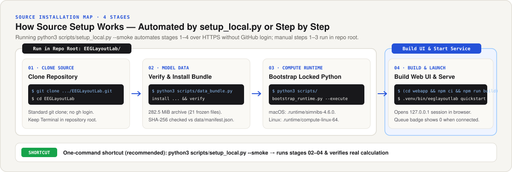
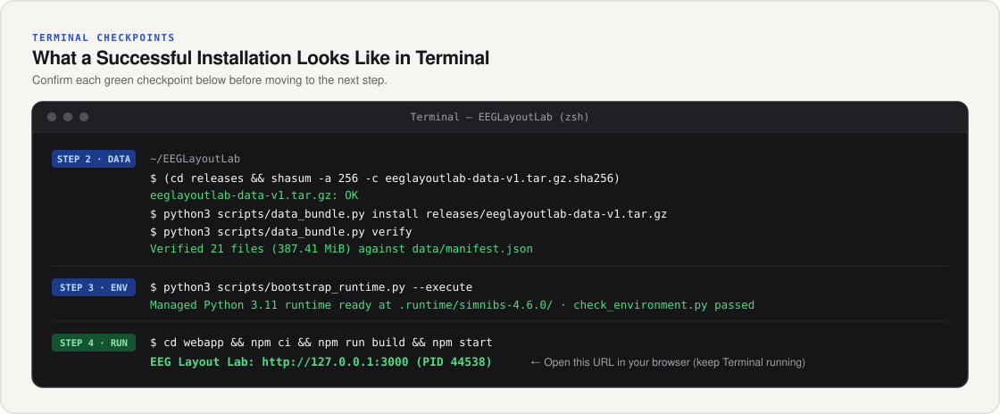
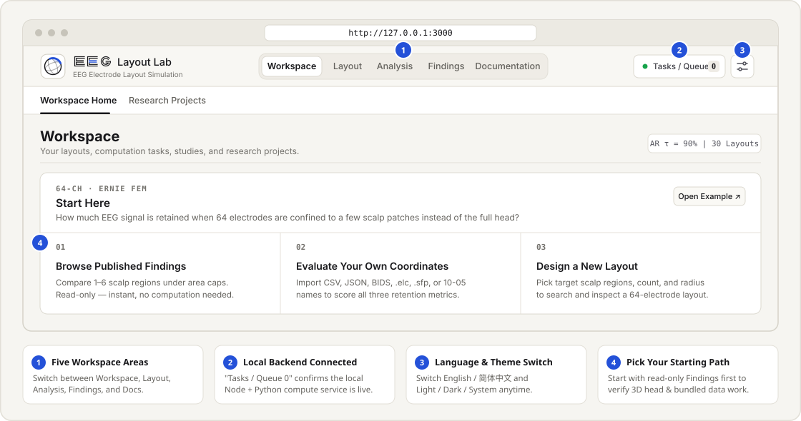

# Source installation

These instructions run the maintained web application locally and prepare a checkout for development. The interface opens in a browser; Node and Python/SimNIBS run on the same computer.

[简体中文源码安装说明](source-installation.zh-CN.md)

This guide covers the **Apple Silicon macOS** setup first. [Linux x86_64](#linux-x86_64) has its own runtime without SimNIBS that computes from published scalp-node tables. [Windows](#windows) is not supported natively yet; use WSL2 (not yet tested). For the planned hosted version, see [Server deployment preparation](server-deployment.md).

## Requirements

- An Apple Silicon Mac running macOS **14 or newer**.
- Node.js **22.13.0 or newer**, with npm.
- Python **3.10 or newer** to run the setup tools. The managed computation environment installs its own **Python 3.11** interpreter, as specified in the [runtime manifest](../configs/runtime/manifest.json).
- An Apple Silicon Conda installation with the `conda` command available in Terminal.
- Git and Apple's Command Line Tools.
- [GitHub CLI](https://cli.github.com/) (`gh`) and a GitHub account with access to this private repository.
- An internet connection for installing dependencies.

Use the native Apple Silicon versions of these tools, without Rosetta. The runtime itself stays native. Only building head packages with `charm` also needs Rosetta 2 installed, for SimNIBS's bundled x86_64 tools (see [server deployment](server-deployment.md#building-head-packages)).

## First-time setup



### 1. Clone the repository

Open Terminal, sign in with the account that has repository access, and clone the current development source:

```sh
gh auth login
gh repo clone Yiming-S/EEGLayoutLab
cd EEGLayoutLab
```

Keep this Terminal window open for the following steps. The repository root is the folder containing `scripts/` and `webapp/`. Create a working branch with `git switch -c codex/my-changes` before editing the source. The data installer checks the archive against the manifest in this checkout; use the archive named below while that manifest remains the current one.

### 2. Install the model data

Download the matching `eeglayoutlab-data-v1.tar.gz` archive and checksum from [Release v0.2.0](https://github.com/Yiming-S/EEGLayoutLab/releases/tag/v0.2.0). Install this archive separately from the source code. This repository is private, so the release page and assets require repository access.

From the repository root, download and check the archive:

```sh
mkdir -p releases
gh release download v0.2.0 --repo Yiming-S/EEGLayoutLab \
  --pattern eeglayoutlab-data-v1.tar.gz \
  --pattern eeglayoutlab-data-v1.tar.gz.sha256 \
  --dir releases
(cd releases && shasum -a 256 -c eeglayoutlab-data-v1.tar.gz.sha256)
```

After the checksum succeeds, install the data **from the repository root, not from `webapp/`**:

```sh
python3 scripts/data_bundle.py install releases/eeglayoutlab-data-v1.tar.gz
python3 scripts/data_bundle.py verify
```

The bundle contains 21 files totaling 406,226,293 bytes (387.41 MiB), including the data-source declaration and selected frozen inputs and records. Complete historical calculation directories are excluded. If you download through the browser, place the archive and checksum in `releases/` before running the check and installation commands. Continue only after installation and verification succeed.

### 3. Install the Python computation environment

From the repository root, run:

```sh
python3 scripts/bootstrap_runtime.py --execute
```

Wait for installation and the environment check to finish successfully before continuing. The web service selects this environment automatically; no manual Conda activation is needed.

### 4. Install the web dependencies and open the browser interface

```sh
cd webapp
npm ci
npm run dev
```



Open [http://127.0.0.1:3000](http://127.0.0.1:3000) in your browser. Keep Terminal running while using the application. Press **Control + C** in Terminal to stop it. On first launch, check that the top-right **Tasks / Queue** badge shows `0` (connected):



## Open after installation

From the folder containing your checkout, run:

```sh
cd EEGLayoutLab/webapp
npm run dev
```

Then open [http://127.0.0.1:3000](http://127.0.0.1:3000). You do not need to reinstall the data or dependencies each time.

For the application's workflow, see [How to use](../README.md#how-to-use).

## Linux x86_64

Linux uses a smaller computation environment without SimNIBS: Python 3.11.14 with the same numpy 2.3.0, scipy 1.17.1 and threadpoolctl 3.6.0 as the Mac, plus cortech 0.1, numba 0.64.0, llvmlite 0.46.0 and nibabel 5.3.3 for projecting coordinates onto the scalp. The lock is [`manifest-linux-64.json`](../configs/runtime/manifest-linux-64.json), with [`conda-linux-64.explicit.txt`](../configs/runtime/conda-linux-64.explicit.txt) (77 conda-forge packages by URL and SHA-256) and [`pip-linux-64.txt`](../configs/runtime/pip-linux-64.txt) (5 wheels, each with its SHA-256). Nothing is compiled from source.

This environment cannot solve FEM. It computes new coordinates only from a published scalp-node table, and other heads only from their head packages and tables. These are not part of the data bundle; copy them from the Mac that built them (see [server deployment](server-deployment.md#memory-and-the-scalp-node-table)):

- `results/v2/current_scalp_node_table.json` and `results/v2/scalp_node_table/<table_id>/` (2.6 GB): needed for any new coordinates.
- `results/v2/heads/<id>/` (about 1 GB each): needed for cross-head studies.
- `results/v2/scalp_node_table_scenarios/<name>/`: needed for conductivity scenarios.

| Works with the table | Needs the Mac runtime with SimNIBS |
| --- | --- |
| Layout evaluation and perturbation, noise models, conductivity scenarios and other heads (when their tables are installed), radius search, the electrode editor, reception for layouts evaluated from the table, the command line and the examples | Evaluating new coordinates without a table (direct FEM), reception for layouts evaluated by direct FEM, building tables, head packages or the MNI mapping, `charm` |

None of the left-hand paths imports SimNIBS. On Linux, the examples exercised evaluation, radius search and other heads, and the Python tests exercised reception. Conductivity scenarios and the electrode editor were not run separately there.

### Requirements

- Linux on x86_64 with glibc 2.28 or newer (for example Ubuntu 24.04).
- Node.js 22.18 or newer. The command line loads TypeScript files directly. Verified with Node.js 24.22.3.
- Python 3.10 or newer to run the setup tools (Ubuntu's `python3` is enough).
- [Miniforge](https://github.com/conda-forge/miniforge) (`conda`) or [micromamba](https://mamba.readthedocs.io/en/latest/installation/micromamba-installation.html). Git and a compiler are not needed for this environment.

### Install

Install the data bundle as in [step 2](#2-install-the-model-data); on Linux, check the archive with `sha256sum -c` instead of `shasum -a 256 -c`. Copy the table, and any head packages, into `results/v2/`. Then preview and install the environment from the repository root:

```sh
python3 scripts/bootstrap_runtime.py
python3 scripts/bootstrap_runtime.py --execute
```

Add `--conda /path/to/micromamba` if the manager is not on `PATH`. The environment goes into `.runtime/compute-linux-64/`, and the installer ends with `scripts/check_environment.py --native`. On this platform that check imports cortech and numba and projects two points onto a small test surface; it does not need SimNIBS. The web service and the command line select this environment automatically when `.runtime/simnibs-4.6.0/` is absent. Check the installed table with:

```sh
.runtime/compute-linux-64/bin/python scripts/build_scalp_node_table.py --verify
```

### What was verified (2026-11-21)

The checks ran in Docker `linux/amd64` (Ubuntu 24.04), emulated with Rosetta on an Apple M3 Ultra (colima 0.10.3, micromamba 2.10.0, Node.js 24.22.3), with the QA workspace's data, table and eleven head packages mounted read-only. They were repeated on a physical machine on 2026-11-23 ([below](#on-a-physical-machine-2026-11-23)).

- `bootstrap_runtime.py --execute` installed the environment from the lock and `check_environment.py --native` passed.
- The Python fast suite (`-m 'not data_bundle and not native_runtime'`): 564 passed, 4 skipped. A further 60 tests in `test_service_backup.py` and `test_verification_workspace.py` could not start because the container has no `git`; they pass on the Mac. With the data mounted and the real-data reception and search tests switched on (`SOURCE_RECEPTION_REAL_BANK=1 SOURCE_RECEPTION_V2_REAL_BANK=1 LOCAL_RADIUS_REAL_BANK=1`, `-m 'not native_runtime'`), 569 passed. The three tests that need SimNIBS were skipped.
- `build_scalp_node_table.py --verify` passed for the nominal table and for `--head ernie_xh`.
- `node examples/run-examples.mjs --root <checkout>`: all three examples match [`expected.json`](../examples/expected.json) within 1e-6. Over all 22,581 numbers in the result files, the largest difference from the Mac run is 4.1e-14.
- The workers imported numpy, scipy, threadpoolctl and, for evaluation, cortech, numba and nibabel; none imported SimNIBS. Peak memory was 442 MiB for an evaluation worker and 737 MiB for the radius search. Under emulation the examples took 1 min 46 s (35 s natively on the Mac).

### On a physical machine (2026-11-23)

Ubuntu 26.04.1 LTS on an Intel Core i9-14900K (32 threads, 123 GiB RAM). The host had no conda, micromamba, Node.js or curl; micromamba 2.10.0 and Node.js 24.22.3 were downloaded with `wget` into a separate folder and checked against their published SHA-256.

- `bootstrap_runtime.py --execute --conda <micromamba>` installed the environment in 36 s, and `check_environment.py --native` passed.
- The model data was installed as [data packages](data-packages.md). The archives of `base`, `scalp-node-table` and the eleven heads of example 3 (15.1 GB) were copied from the Mac and installed with `eeglayoutlab data install` in 23 s. `eeglayoutlab data verify` checked them in 7 s. `eeglayoutlab data compose` then placed them in a checkout without data as hard links. The examples gave the same numbers from that checkout as from one whose data had been copied in.
- `build_scalp_node_table.py --verify` passed for the nominal table and for all eleven head tables.
- The Python fast suite (`-m 'not data_bundle and not native_runtime'`): 771 passed, 2,544 skipped, 1 failed.
  - The skipped tests need the service extra or the Node reference, which this environment does not install.
  - The failure was Linux-specific: `test_a_service_that_is_stopping_opens_no_browser_and_leaves_no_open_page[CommandLineBrowser]` in `tests/service/test_workspace.py`. On Linux, `eeglayoutlab serve` looked for a browser only inside `webbrowser.open`, after it had written the open page, so a stop that arrived during that lookup was not caught. Commit 5637548 looks up the browser first; with it, a full run passed (778 passed, 2,543 skipped).
  - Two of five full runs ended in a segmentation fault of the interpreter, each at a different place in pure Python code. The same runtime crashed in 1 of 60 runs of a pure parsing loop, with or without numpy. The host's kernel log shows segmentation faults of Python 3.11 to 3.14 since 2026-11-11, most of them on one core, and machine-check events on 2026-11-22. The crashes are therefore attributed to that host, not to the code, and its runs are not a reference for stability.
- `node examples/run-examples.mjs --root <root>`: all three examples match [`expected.json`](../examples/expected.json) within 1e-6. A Mac run of the same code and data was the reference. Of the 22,622 numbers in the result files, 22,568 were identical, and the largest difference was 3.5e-14. Timings and provenance were not compared.
- Peak memory, sampled every 50 ms over the whole process tree:

  | Process | Peak |
  | --- | ---: |
  | Evaluation worker | 375 MiB |
  | Radius search | 699 MiB |
  | Whole tree | 831 MiB |

  The examples took 30 s, against 47 s for the same run on the reference Mac that day.

Cache keys made on Linux include the interpreter version, numpy and scipy versions, the platform, and the environment's conda records and projection-package metadata. A result computed on the Mac is therefore never reused on Linux.

## Windows

Windows is not supported natively yet. Use WSL2 with Ubuntu 24.04 and follow the [Linux](#linux-x86_64) steps inside it; this route has not been tested. A native Windows installation needs:

- **A win-64 lock.** cortech 0.1, numba 0.64.0 and llvmlite 0.46.0 publish cp311 Windows wheels. The conda-forge packages still have to be resolved and checked. `bootstrap_runtime.py` and `check_environment.py` assume `<prefix>/bin/python` and `lib/python3.11/site-packages`, but a Windows Conda prefix uses `python.exe` and `Lib/site-packages`.
- **Runtime lookup.** `webapp/server/project-paths.mjs` and `webapp/server/runtime/scientific-context.mjs` use the same POSIX paths. Until they change, `EEG_COMPUTE_PYTHON=C:\path\to\python.exe` selects an interpreter for search and evaluation. Cache keys then record only the interpreter fingerprint.
- **File locking.** `src/compact_eeg/workflows/reception_forward_provider.py` imports `fcntl`, which Windows lacks, so reception (signal experiments) fails at import. Table evaluation and radius search do not import it. Moving the import into the native-solve lock fixes this. That file is part of the scientific identity, though, so the change would give every design-evaluation cache key a new value on every platform. It has not been made.
- **Line endings.** `.gitattributes` turns off line-ending conversion. Otherwise Git for Windows would check out `data/manifest.json` with CRLF, and `data_bundle.py install` would refuse the archive because its manifest must be byte-identical.
- **Worker stop.** The worker transport (`webapp/server/jobs/python-worker.mjs`) has no process group on Windows. Stopping a job ends only the Python process, which is enough for table-path workers because they start no child processes.
