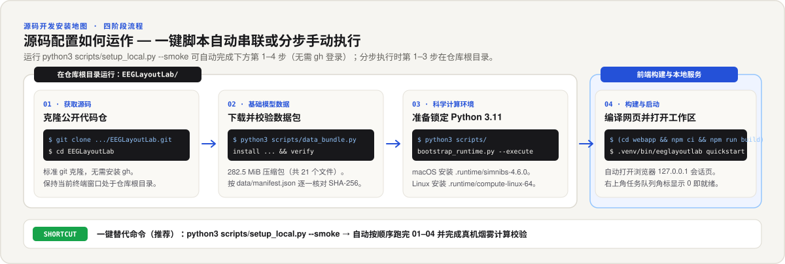
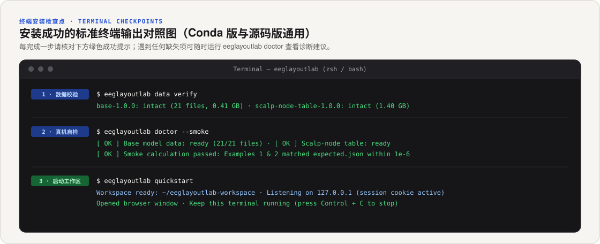
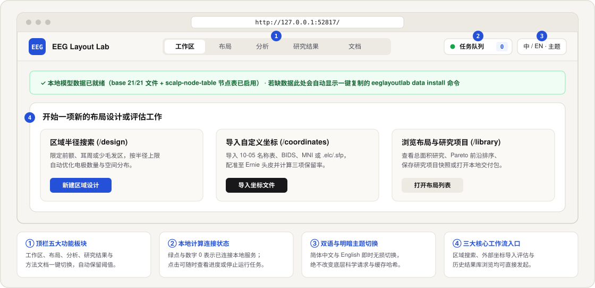

# 源码安装说明

本说明用于在本机运行和开发目前维护的网页版。界面在浏览器中打开，本地 Python 服务（`eeglayoutlab serve`）及其 Python／SimNIBS 计算进程运行在同一台电脑上。

[English source installation](source-installation.md) · [完整安装手册（Conda 推荐版）](installation.zh-CN.md) · [完整使用手册（图文版）](user-manual.zh-CN.md)

本指南先介绍 **Apple Silicon macOS** 的安装流程。**Linux x86_64** 有一套不含 SimNIBS 的计算环境，依靠已发布的头皮节点表计算，见文末[Linux x86_64](#linux-x86_64)。**Windows** 暂不支持原生安装，请使用 WSL2（尚未测试）。服务器部署使用旧版 Node 服务，已冻结在标签 `node-host-freeze`，见[服务器部署准备说明（英文）](server-deployment.md)。

## 准备条件

- Apple Silicon（M 系列芯片）Mac，macOS **14 或更新版本**。
- Node.js **22.18.0 或更新版本**，以及 npm，用于构建界面。
- 任意系统自带的 **Python 3.9 或更新版本**（`python3`），用于运行一键初始化脚本 `scripts/setup_local.py`。**无需单独安装 Python 3.11 或 `gh`**：脚本会自动准备固定版本的 **Python 3.11** 计算环境（见[运行环境清单](../configs/runtime/manifest.json)），并直接复用该解释器创建隔离的 `.venv` 服务环境。
- Apple Silicon 版本的 Conda，且终端中可以运行 `conda` 命令。
- Git 和 Apple 命令行工具（可选安装 [GitHub 命令行工具](https://cli.github.com/) `gh` 用于命令行下载发布附件）。
- 安装依赖时需要联网。

使用上述工具的原生 Apple Silicon 版本，不通过 Rosetta 运行。运行环境本身保持原生；只有用 `charm` 构建头模包时，还需安装 Rosetta 2 来运行 SimNIBS 自带的 x86_64 工具（见 [server deployment](server-deployment.md#building-head-packages)）。

## 一键快速配置（推荐，3 行命令）

克隆源码后，直接运行 `scripts/setup_local.py` 即可自动完成全部四步配置（匿名通过 HTTPS 下载并按 SHA-256 校验 `v0.2.0` 基础数据包，无需登录 GitHub 或安装 `gh`；自动识别 Conda／Miniforge／micromamba 配置 `.runtime/` 计算环境；自动创建 `.venv` 并安装 `eeglayoutlab`；自动构建 `webapp/` 前端静态页面；最后执行真实计算自检）：

```sh
git clone https://github.com/Yiming-S/EEGLayoutLab.git && cd EEGLayoutLab
python3 scripts/setup_local.py --smoke
.venv/bin/eeglayoutlab quickstart
```

重复运行 `python3 scripts/setup_local.py` 会自动跳过已完成的步骤（传入 `--plan` 可在不改动任何文件的前提下预览各步状态；在 Linux 上如需评估自定义坐标，可再运行 `.venv/bin/eeglayoutlab data install scalp-node-table --compose`）。

## 分步手动安装（参考）



### 1. 克隆仓库

打开终端并克隆源码（可直接通过 GitHub 仓库页面地址或 `gh` 克隆）：

```sh
gh repo clone Yiming-S/EEGLayoutLab
cd EEGLayoutLab
```

后续步骤继续在这个终端窗口中操作。仓库根目录是同时包含 `scripts/` 和 `webapp/` 的文件夹。修改源码前请先创建工作分支。数据安装工具会按当前源码中的清单核对数据包；下文列出的数据包对应当前清单。

### 2. 安装模型数据

从 [v0.2.0 版本页面](https://github.com/Yiming-S/EEGLayoutLab/releases/tag/v0.2.0)将匹配的 `eeglayoutlab-data-v1.tar.gz`（压缩包约 282.5 MiB，展开 387.41 MiB）及 `eeglayoutlab-data-v1.tar.gz.sha256` 下载到 `releases/` 目录（无需登录 GitHub，可直接用浏览器下载或用下方 `gh` 命令获取）。数据包与源码分别安装。

在仓库根目录下载（若使用 `gh`）并校验数据包：

```sh
mkdir -p releases
gh release download v0.2.0 --repo Yiming-S/EEGLayoutLab \
  --pattern eeglayoutlab-data-v1.tar.gz \
  --pattern eeglayoutlab-data-v1.tar.gz.sha256 \
  --dir releases
(cd releases && shasum -a 256 -c eeglayoutlab-data-v1.tar.gz.sha256)
```

校验成功后，**在仓库根目录运行，不是在 `webapp/` 中运行**：

```sh
python3 scripts/data_bundle.py install releases/eeglayoutlab-data-v1.tar.gz
python3 scripts/data_bundle.py verify
```

数据包共含 21 个文件，总计 406,226,293 字节（387.41 MiB），包含数据来源说明、选定的固定输入和记录，不包含完整历史计算目录。如果通过浏览器下载，先将数据包和校验文件放入 `releases/`，再运行校验与安装命令。安装与验证成功后，再继续下一步。

### 3. 安装 Python 计算环境

在仓库根目录运行：

```sh
python3 scripts/bootstrap_runtime.py --execute
```

等待安装和环境检查成功完成，再继续下一步。网页服务会自动使用该环境，无需手动激活 Conda 环境。

### 4. 安装 `eeglayoutlab` 命令、构建界面并启动应用

在仓库根目录，把命令安装到自备的 Python 3.11 环境中，构建一次界面，然后为一个**工作区**启动本地服务。工作区是你自选的目录，保存任务列表、电极名称、稳健性研究和研究项目：

```sh
python3.11 -m venv .venv
.venv/bin/python -m pip install -e '.[service]'
(cd webapp && npm ci && npm run build)
.venv/bin/eeglayoutlab serve ~/eeglayoutlab-workspace
```



服务会打印地址 `http://127.0.0.1:<端口>/open?token=…`，并在就绪后用浏览器打开它。请使用这个页面：该地址负责让浏览器登录本地服务，而且每次启动的端口都不同，所以书签或手动输入的地址无法打开应用。使用期间保持终端运行；结束使用时，在终端按 **Control + C** 停止服务。

若要一次性验证科学计算环境与模型数据均已就绪（在 M 系列 Mac 上约 13–35 秒），可在另一终端窗口运行示例 1 和示例 2：

```sh
.venv/bin/eeglayoutlab examples run --skip-cross-head
```

首次打开浏览器页面后，确认右上角**任务 / 队列**显示 `0`（已连接本地服务）即可开始使用：



## 安装完成后，每次怎么打开

在存放仓库的上一级文件夹中，运行：

```sh
cd EEGLayoutLab
.venv/bin/eeglayoutlab serve ~/eeglayoutlab-workspace
```

命令会在浏览器中打开应用。不需要每次重新安装数据和依赖；更新源码后，重新构建一次界面（`cd webapp && npm run build`）。上一次运行留下的标签页无法连接新的服务，页面会提示重新运行命令，命令会打开新的页面；服务运行时再次运行命令，会打开正在运行的实例。命令的其他选项，以及界面开发用的 `npm run dev`，见 [CONTRIBUTING（英文）](../CONTRIBUTING.md#the-local-service)。

旧版 Node 服务（`webapp/` 中的 `npm start`）仅作保留，服务器部署冻结在标签 `node-host-freeze`；当前界面不再打开它保存的研究项目。

操作流程见 [安装与使用](getting-started.zh-CN.md#使用顺序)。

## Linux x86_64

Linux 使用较小的计算环境：Python 3.11.14，numpy、scipy 与 Mac 版本相同，另含 cortech、numba、llvmlite 和 nibabel，不含 SimNIBS。锁文件为 [`manifest-linux-64.json`](../configs/runtime/manifest-linux-64.json)、[`conda-linux-64.explicit.txt`](../configs/runtime/conda-linux-64.explicit.txt) 和 [`pip-linux-64.txt`](../configs/runtime/pip-linux-64.txt)，每个包都记录 SHA-256，不从源码编译。

该环境不能求解 FEM。仅安装 `base` 数据包时，即可运行区域半径搜索（`search`）与 v1 信号仿真；若要评估导入或新构造的电极坐标（`evaluate`），还需安装名义头皮节点表数据包（`scalp-node-table`，归档约 1.40 GB，展开约 2.6 GB）；跨头模研究还需安装各头模包（`head-<id>`）。可通过[数据包工具](data-packages.md)（`eeglayoutlab data install` 与 `eeglayoutlab data compose`）安装，或从构建它们的 Mac 复制。

需要 x86_64 Linux（glibc 2.28 或更新，例如 Ubuntu 24.04）、Node.js 22.18.0 或更新（源码检出仅在构建 `webapp/` 与运行跨语言对拍测试时需要，`eeglayoutlab` 命令行本身为纯 Python）、Python 3.9 或更新，以及 Miniforge 或 micromamba；不需要编译器。推荐直接运行 `python3 scripts/setup_local.py --smoke` 后执行 `.venv/bin/eeglayoutlab data install scalp-node-table && .venv/bin/eeglayoutlab data compose`；若按分步手动安装，先按第 2 步安装基础数据（Linux 上用 `sha256sum -c` 校验），通过 `eeglayoutlab data install` 与 `data compose` 安装并链接头皮节点表，然后在仓库根目录运行：

```sh
python3 scripts/bootstrap_runtime.py
python3 scripts/bootstrap_runtime.py --execute
.runtime/compute-linux-64/bin/python scripts/build_scalp_node_table.py --verify
```

环境安装在 `.runtime/compute-linux-64/`。没有 `.runtime/simnibs-4.6.0/` 时，网页服务和命令行会自动选用它。2026-11-21 在 Docker `linux/amd64`（Apple M3 Ultra 上经 Rosetta 模拟）中验证：三个示例与 `expected.json` 的差异都在 1e-6 以内，与 Mac 结果的最大差为 4.1e-14。2026-11-23 在实体 x86_64 机器（Ubuntu 26.04.1 LTS，Intel Core i9-14900K）上复验：模型数据用 `eeglayoutlab data install` 安装并校验；三个示例与 `expected.json` 一致，与同一代码的 Mac 结果最大差为 3.5e-14；评价进程峰值内存 375 MiB，半径搜索 699 MiB。完整说明见[英文版](source-installation.md#linux-x86_64)。

## Windows

暂不支持原生安装，请在 WSL2（Ubuntu 24.04）中按 Linux 步骤安装（尚未测试）。原生安装还需要：win-64 锁文件；运行时路径支持 `python.exe` 和 `Lib/site-packages`；去掉 `reception_forward_provider.py` 中 Windows 没有的 `fcntl`（这会改变所有设计评价的缓存键，尚未修改）。仓库已加入 `.gitattributes`，避免 Git for Windows 转换换行符导致数据清单校验失败。详见[英文版](source-installation.md#windows)。
