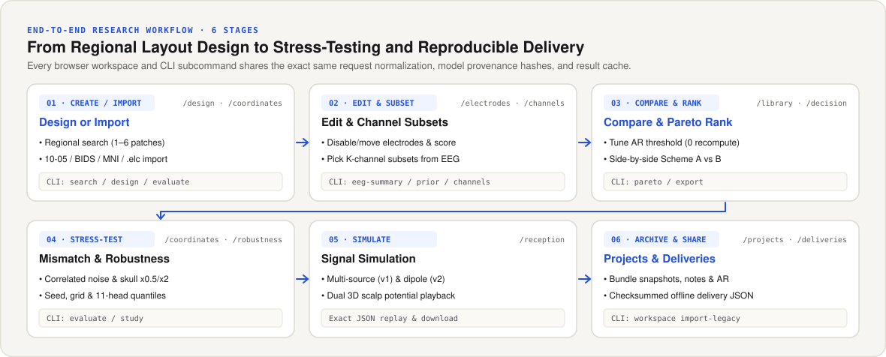
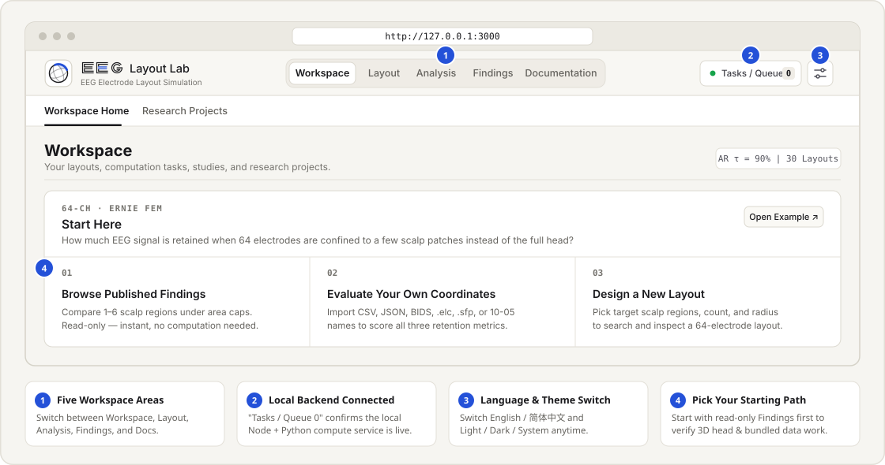
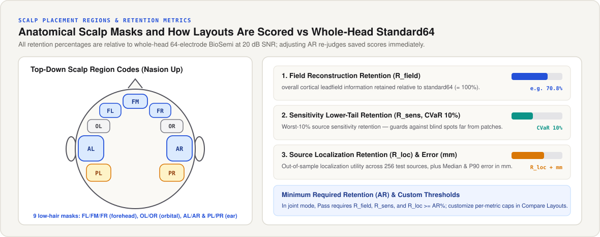
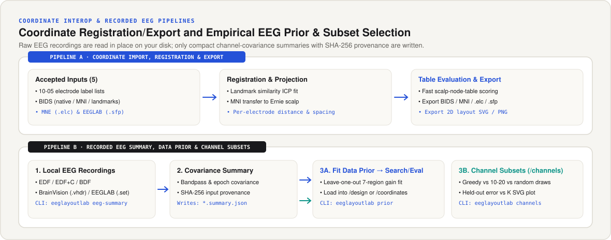

# User Manual

This manual covers every feature of **EEGLayoutLab** across both the interactive browser workspace and the `eeglayoutlab` command line: navigating the five top-bar areas, interpreting retention metrics, designing compact regional layouts, importing and editing electrode coordinates, comparing candidates, stress-testing model assumptions across noise/conductivity/heads, simulating cortical signals, fitting priors from recorded EEG, archiving reproducible project deliveries, and scripting batch workflows.

[简体中文完整使用手册](user-manual.zh-CN.md) · [Installation Manual](installation.md) · [Command-Line Reference](command-line.md) · [Model & Metrics](model-and-metrics.md)

## 1. Overview and end-to-end research workflow

Conventional whole-head 64-channel EEG caps provide broad spatial sampling, whereas wearable, ambulatory, sleep, or peri-auricular / forehead devices restrict electrodes to compact scalp patches. EEGLayoutLab quantifies what a compact or custom electrode layout retains—and what it loses—relative to the whole-head 64-electrode BioSemi reference (`standard64`) on a realistic finite-element head model (SimNIBS subject **Ernie**, plus 11 cross-subject validation heads).



Every workflow in the browser and on the command line shares the **same request normalization, scientific provenance hash, and result cache**:

1. **Create or Import (`/design`, `/coordinates`)**: Search for optimal compact regional layouts (`8, 12, 16, 24, 32, 48, or 64` electrodes across `1, 2, 3, 4, or 6` scalp patches, with equal or adaptive cross-region quotas) or import existing 10-05, BIDS, MNI, digitized landmark, `.elc`, or `.sfp` coordinates.
2. **Refine or Select Subsets (`/electrodes`, `/channels`)**: Relocate or disable individual electrodes on a saved layout and re-score, or select `K`-channel subsets directly from empirical EEG recording covariances.
3. **Compare & Rank (`/library`, `/decision`)**: Rank candidate layouts by multi-objective Pareto dominance, adjust the global **Minimum Required Retention (`AR`)** threshold without recomputing, and run side-by-side Scheme A vs. Scheme B evaluations.
4. **Stress-Test Assumptions (`/coordinates`, `/robustness`)**: Evaluate layouts under spatially correlated noise, skull-conductivity mismatch (`skull_x0.5`, `skull_x2`), cross-session dropout/impedance/cap re-placement, or multi-case batch studies (`noise_seeds`, `grid_displacements`, and 11 `heads`).
5. **Simulate Signals (`/reception`)**: Inspect multi-source regional (`v1`) or single-dipole cortical (`v2`) EEG waveforms and dual 3D scalp potential topographies side by side with `standard64`.
6. **Archive & Share (`/projects`, `/deliveries`)**: Save immutable snapshots, comparison thresholds, and study notes into a **Research Project**, then export a self-contained, SHA-256-verified **Project Delivery Package** that any colleague can inspect offline in their browser.

## 2. Interface tour, top-bar navigation, and workspace sessions

Start the local application with `eeglayoutlab quickstart` (or `eeglayoutlab serve ~/eeglayoutlab-workspace`; see the [Installation Manual](installation.md)).



### Top-bar areas and routes

| Top-bar area | Sub-pages & routes | Primary purpose |
| --- | --- | --- |
| **Workspace** | Home (`/`) · Research Projects (`/projects`) · Delivery Reader (`/deliveries`) | Monitor readiness & active tasks, resume recent work, organize project snapshots, and open offline delivery packages |
| **Layout** | Layout List (`/library`) · Layout Detail (`/layout`) · Region Design (`/design`) · Coordinate Import (`/coordinates`) · Electrode Editor (`/electrodes`) | Browse and filter all saved layouts, inspect 3D scalp geometry, search new regional layouts, import external montages, or edit individual channels |
| **Analysis** | Compare Layouts (`/decision`) · Robustness Studies (`/robustness`) · Signal Simulation (`/reception`) · Channel Subsets (`/channels`) | Perform Scheme A vs. B qualification checks, run multi-case sensitivity batches, simulate time-domain scalp potentials, and select empirical subsets |
| **Findings** | Total-Area Study (`/findings`) · Historical Batches (`/results`, `/pilot-results`) | Explore the curated 30-condition area-budget Pareto study (`strict_area`) and earlier benchmark batches |
| **Documentation** | User Guide (`/guide`) · Models & Methods (`/method`) · Full Site (`/docs/`) | Read quick interactive explanations, mathematical definitions, and full reference chapters |

### Global controls that never trigger recomputation

- **Minimum Required Retention (`AR`) slider**: Retained across page navigation (`?ar=...`). Changing `AR` (for example from `45%` to `60%`) immediately updates pass/fail badges and comparison verdicts using already-saved scores—**it never starts a background job**.
- **Language (`English` / `简体中文`) & theme toggle**: Switching language translates all system labels, anatomical region names, worker diagnostics, and exported Markdown reports while keeping raw JSON blocks, numerical scores, and scientific cache keys byte-identical.
- **Tasks / Queue badge**: Shows `0` with a green dot when idle and connected. One computation runs at a time per installation so multi-threaded numerical workers never contend for CPU or memory; additional submissions wait cleanly in your workspace queue (`<workspace>/.eeglayoutlab/queue.json`) and can be cancelled at any moment.

## 3. Scalp placement regions, metrics, and qualification rules

Understanding the nine anatomical scalp masks and the three core retention metrics makes every chart and table in EEGLayoutLab straightforward to read (full mathematical derivations live in [Model and metrics](model-and-metrics.md) and [Method details](method-details.md)).



### Placement domains and anatomical region codes

When designing a regional layout, you constrain where patch centers and electrodes may sit on the admissible Ernie scalp mesh (`4,847` candidate vertices with at least `4 mm` inter-electrode spacing):

- **Whole Scalp (`whole_surface` / `whole_scalp_free`)**: Patches may be placed anywhere on the admissible scalp surface.
- **Low-Hair Scalp (`low_hair` / `low_hair_free`)**: Restricts placement to forehead and peri-auricular / low-hair regions suitable for wearable headbands or ear-EEG patches.
- **Preset Anatomical Regions (`preset`)**: Assigns each patch explicitly to one of nine coordinate-defined low-hair masks:
  - `FL`, `FM`, `FR`: Left, middle, and right forehead regions
  - `OL`, `OR`: Left and right superolateral periorbital regions
  - `AL`, `AR`: Left and right expanded peri-auricular (around-ear) regions
  - `PL`, `PR`: Left and right near-postauricular (behind-ear) regions

### Core evaluation metrics (relative to `standard64` at 20 dB SNR)

| Metric label in UI | JSON field | Interpretation |
| --- | --- | --- |
| **Field Reconstruction Retention (`R_field`)** | `field_relative` | Fraction of cortical source-space log-determinant information / variance retained across the `4,096`-source forward dictionary relative to whole-head `standard64` (`100%`) |
| **Sensitivity Lower-Tail Retention (`R_sens`)** | `sensitivity_tail` | Worst-`10%` (CVaR) cortical source sensitivity relative to `standard64`; detects blind spots in deep or distant brain regions |
| **Source Localization Retention (`R_loc`)** | `localization_relative` | Out-of-sample localization utility retained across `256` held-out test sources (separate from the search dictionary) relative to `standard64` |
| **Median / P90 Localization Error (`mm`)** | `median_mm`, `p90_mm` | Point-localization error quantiles in millimeters (lower is better; compare directly against `reference_median_mm` and `reference_p90_mm`) |
| **Union Patch Area (`cm²`)** | `union_area_cm2` | Total scalp surface area covered by the active regional patches |

**Qualification rule:** Under **Joint (`AR`)** mode, a layout passes (`Pass`) if and only if `R_field >= AR%`, `R_sens >= AR%`, and `R_loc >= AR%`. In **Compare Layouts (`/decision`)**, switch to **Custom** mode whenever you want independent thresholds per metric or an explicit millimeter cap on `P90` localization error (for example `R_field >= 65%`, `R_sens >= 20%`, `P90 <= 25 mm`).

## 4. Exploring Findings, the Layout List, and the 3D Head Viewer

### Findings (`/findings`)

Open **Findings → Total-Area Study** to inspect the 30-condition fixed-area campaign (`strict_area`: whole-scalp vs. low-hair across total area budgets from `40 cm²` to `240 cm²` and `1` to `6` patches). Click **View layout & metrics** on any row to open an interactive side sheet with its 3D head rendering and retention breakdown without leaving the table.

### Layout List (`/library`) and Layout Page (`/layout`)

1. Open **Layout → Layout List** to browse all records across built-in studies and your local computations:
   - Filter by **Protocol** (`All`, `Local radius cache`, `Total-area study`, `Coordinate evaluations`, `Electrode edits`), **Region count**, **Electrode count**, or search keywords (such as `AL`, `ear`, `forehead`, or a custom design name).
   - Rank records within a matched evaluation condition by **Pareto dominance** (Rank 1 = non-dominated frontier across your selected objectives).
2. Click **View layout** on any row to open its dedicated **Layout Page (`/layout`)**:
   - **3D Head Stage**: Drag to orbit, scroll to zoom, toggle between candidate electrodes (colored by region) and the faint `standard64` reference positions, and inspect cortical ROI surfaces.
   - **All Evaluations of One Geometry**: If the same 64 coordinates have been evaluated under nominal Ernie, correlated noise, skull conductivity scenarios, or other heads, all evaluations are grouped cleanly on one page—nominal Ernie first—with direct action buttons to **Compare**, **Edit Electrodes**, **Simulate Signals**, or **Create Robustness Study**.

## 5. Designing regional layouts (`Layout → Region Design`)

Use **Layout → Region Design (`/design`)** to discover optimal electrode placements under geometric patch constraints:

1. **Choose region count (`1, 2, 3, 4, or 6`), placement mode, and channel quota**: Pick **Whole Scalp**, **Low-Hair**, or **Preset Masks** (for example `2` regions on `AL` + `AR`, or `3` regions on `PL` + `PR` + `FM`), and choose **Equal split per region** (default) or **Adaptive cross-region quota** (`R >= 2`, keeping at least 4 anchor electrodes per region).
2. **Set per-region geodesic radius cap (`15–80 mm`, step `5 mm`), channel count (`K`), and search objective**:
   - Adjust the maximum geodesic radius per patch (e.g., `20–45 mm`) and choose **Lower-tail minimax** (default) or **Subspace-info composite**.
   - Choose total electrodes `K` from **`8, 12, 16, 24, 32, 48, or 64`** (default `64`). Notably, under tight patch caps (`25–35 mm`), `24` or `32` well-placed electrodes often match or exceed `64` crowded electrodes on out-of-sample localization retention while halving hardware channels.
3. **Optional noise model or empirical prior**: Keep default independent sensor noise (`iid`), choose spatially correlated noise (`spatial_10`, `spatial_20`, `spatial_40`) or `brain_background`, or upload a fitted `eeg-data-prior/1` JSON file.
4. **Check cache or submit search**:
   - If the exact normalized request has already been computed on your installation, the button reads **Load saved result** and replays the verified cache immediately.
   - Otherwise click **Start search**; the convergent Fedorov exchange + confusion-margin reranking worker runs in the background and saves the resulting record to your library automatically.
   - Copy the page URL with `?draft=1&...` anytime to share or bookmark parameter settings without triggering implicit jobs.

## 6. Importing custom coordinates and editing electrodes



### Coordinate Import (`Layout → Coordinate Import`, `/coordinates`)

Evaluate any existing cap, CAD layout, or digitized montage registered to the Ernie head model (requires `scalp-node-table` or SimNIBS; see [Coordinate file interface](coordinate-file-interface.md) for exact file schemas):

1. **Select input file(s)** — five formats are accepted directly in the browser and via `eeglayoutlab design`:
   - **10-05 label list (`.tsv` / `.csv` / `.txt`)**: 64 standard 10-05 names (legacy aliases `T3/T4/T5/T6` automatically map to `T7/T8/P7/P8`), with an optional region column.
   - **BIDS pair (`*_electrodes.tsv` + `*_coordsystem.json`)**: Supports Ernie native millimeters (`ernie_native_mm`), MNI template space (`MNI152NLin2009bAsym` / `fsaverage` nonlinear surface transfer), or **digitized subject head frames** containing fiducial landmarks (`NAS` / `LPA` / `RPA`, aligned via 500-iteration similarity ICP).
   - **MNE-Python montage (`.elc`)** or **EEGLAB montage (`.sfp`)** with explicit unit declaration (`mm`, `cm`, or `m`).
   - **Design JSON (`eeg-electrode-design/1`)** or **Importable layout CSV / Reproducibility bundle**.
2. **Review per-electrode projection before & after scoring**:
   - Every imported coordinate is projected onto the admissible Ernie outer scalp surface. Inspect each channel's input coordinates, projected coordinates, and projection distance (`mm`); points lying more than `10 mm` off the scalp or closer than `3 mm` after cross-head mapping are flagged clearly with exact diagnostics.
   - Electrode names and coordinate-source metadata are saved privately in `<workspace>/annotations/electrode-names/` so your custom labels persist across sessions without changing numerical cache keys.
3. **Choose evaluation condition**: Run **Evaluate** (or **Position-offset perturbation**) with configurable jitter radius (`mm`, default `6 mm`), random seed (`42`), optional noise model, skull conductivity (`skull_x0.5` / `skull_x2`), or cross-session robustness (`standard/1`: dropout, contact-impedance spread, and cap re-placement).
4. **Export in standard neuroinformatics formats**: Download your design as Ernie native BIDS, MNI BIDS, MNE `.elc`, EEGLAB `.sfp`, CSV, 2D publication SVG/PNG layout figure, or full reproducibility JSON bundle.

### Electrode Editor (`Layout → Electrode Editor`, `/electrodes`)

To prune channels or test hardware knockouts starting from a saved 64-electrode layout:

1. Open a layout on `/layout` and click **Edit Electrodes** (or visit `/electrodes` and pick a parent layout).
2. Uncheck individual electrodes (e.g., disable `E1` to test a 63-channel failure, or prune down to a custom subset) or move an electrode to another admissible vertex within its patch.
3. Click **Evaluate and save copy**. The original 64-electrode parent record remains untouched while the edited copy is scored and linked under the parent's history.

## 7. Comparing layouts and running robustness studies

### Side-by-side comparison (`Analysis → Compare Layouts`, `/decision`)

1. Choose **Scheme A** (for example a whole-head reference or 4-patch design) and **Scheme B** (for example a 2-patch `AL + AR` ear-EEG design). When a layout has multiple evaluations (nominal, correlated noise, skull `x2`), a second dropdown lets you pick the exact condition on each side.
2. Choose **Joint (`AR`)** or **Custom** qualification requirements (`R_field`, `R_sens`, `R_loc`, `P90 mm`).
3. Read the structured side-by-side verdict, metric deltas, and geometry comparison, then click **Export comparison report (Markdown)** to download a clean, bilingual report containing byte-identical provenance JSON blocks for supplementary material.

### Multi-case batch studies (`Analysis → Robustness Studies`, `/robustness`)

Single evaluations use one random seed or nominal head. **Robustness Studies** ([protocol details](robustness-studies.md)) quantify empirical variability across `1–12` explicit cases in one batch:

1. Start from **Coordinate Import → Create a robustness study with these coordinates**, from a saved 64-electrode layout, or directly on `/robustness`.
2. Pick one of the three batch protocols:
   - **`noise_seeds`**: Repeats evaluation across distinct localization-noise random seeds.
   - **`grid_displacements`**: Applies rigid tangential scalp-grid offsets to test cap placement shift sensitivity.
   - **`heads`**: Projects and evaluates the layout across up to 11 anatomical head packages (`ernie_xh` + 10 `ixi*` subjects; install via `eeglayoutlab data install --examples`).
3. Click **Save draft**, then **Start study**. Each case runs through the shared workspace queue and archives an immutable snapshot under `<workspace>/studies/<id>/snapshots/`. If you stop `eeglayoutlab serve` mid-batch, reopen `/robustness` next time and click **Resume study**—completed cases are reused immediately.
4. Once finished, inspect case-by-case status (including any geometry-rejected trials on extreme shifts) and empirical Type-7 quantiles (**Median**, **P10**, **P90**) across all three retention metrics.

## 8. Simulating cortical signals (`Analysis → Signal Simulation`, `/reception`)

Signal Simulation lets you see how a candidate layout actually records time-domain brain activity and spatial scalp potentials compared to `standard64`:

1. **Select a compatible layout**: Signal simulation requires a 64-electrode layout evaluated under the default independent-noise protocol. *(Layouts optimized specifically under spatially correlated noise or custom data priors display an explicit protocol explanation instead of a simulation link so noise assumptions are never mixed silently.)*
2. **Choose source mode**:
   - **Multi-source regional activity (`v1`)**: Available in **all** installations (both Conda package and source checkout, needing only `base`). Simulates distributed cortical activity in a chosen region (`frontal`, `temporal`, `parietal`, `occipital`, etc.) with selectable waveforms (`burst`, `oscillation`, `erp`) and artifact scaling.
   - **Single-source cortical dipole (`v2`, `dk40-six-roi-v1`)**: Selects a specific cortical source index (`0..255` frozen test sources) for high-resolution single-dipole forward comparison. Computing a *new* `v2` job requires a source checkout with SimNIBS; stored `v2` records and project deliveries open and play back in every installation.
3. **Interactive waveform & 3D potential playback**:
   - Press **Play time marker** (or drag the **Waveform observation time** slider) to animate scalp potentials simultaneously across both 3D heads (**Reference 64** on the left, **Candidate layout** on the right).
   - Switch **Inspect electrode** channel selectors to compare single-channel traces and SNR, and click **Export scenario JSON** to save the complete time-series and metadata payload.

## 9. Using recorded EEG: priors and channel subsets

If you have real experimental recordings (`EDF` / `EDF+C`, `BDF`, BrainVision `.vhdr`, or EEGLAB `.set`), EEGLayoutLab can tailor layout search and channel pruning to your paradigm without uploading raw data anywhere:

### Step 1 — Summarize recordings locally (`eeg-summary`)

```sh
eeglayoutlab eeg-summary /path/to/recordings/*.edf \
  --band 1,40 --epoch 2 --label "resting-alpha" \
  --out-dir ./summaries
```

Each recording stays untouched on disk; `eeg-summary` writes a compact `<stem>.summary.json` (`eeg-covariance-summary/1`) recording channel labels, bandpass covariance, and the input files' byte counts and SHA-256 hashes.

### Step 2A — Fit a regional cortical prior (`prior`) for layout design

```sh
eeglayoutlab prior ./summaries --out ./empirical-prior.json
```

This fits 7-region cortical gain weights and sensor noise parameters with leave-one-out cross-validation printed to Terminal. Load `empirical-prior.json` on **Region Design (`/design`)** or **Coordinate Import (`/coordinates`)** (or pass `--data-prior ./empirical-prior.json` on the CLI) to optimize layouts specifically for your empirical signal distribution.

### Step 2B — Select optimal `K`-channel subsets (`Analysis → Channel Subsets` or `channels`)

Open **Analysis → Channel Subsets (`/channels`)** in the browser and drop your `.summary.json` files (computation runs 100% client-side in the browser), or run on the command line with held-out test recordings and an SVG error plot:

```sh
eeglayoutlab channels ./train-summaries \
  --test ./test-summaries \
  --prior ./empirical-prior.json \
  --counts 8,16,24,32 \
  --draws 200 --seed 1 \
  --out ./subset-report.json \
  --figure ./subset-curve.svg
```

Both interfaces compare **Greedy Schur/ridge subset selection** against standard **10-20 subsets** and **200 Monte Carlo random subsets**, reporting training and held-out reconstruction error at each channel count `K`.

## 10. Research projects and reproducible deliveries (`/projects` & `/deliveries`)

Use **Workspace → Research Projects (`/projects`)** to curate paper figures, supplementary tables, and collaborator handoffs:

1. **Create a workspace project**: Give the project a title and descriptive author/owner label (stored as plain files under `<workspace>/projects/<uuid>/`; no passwords or access keys are needed).
2. **Attach immutable snapshots**: Save key layouts, 63/32-channel edited copies, and completed signal simulations into the project, write structured Markdown notes, and lock your comparison reference/candidate pair and `AR` thresholds. Snapshots copy and checksum the underlying scientific JSON so they remain intact even if the computation queue ages out or environments change.
3. **Export a Project Delivery Package**: Click **Download project delivery package**. The resulting `.json` bundle (`research-project-delivery/1`) embeds every archived scientific payload, SHA-256 checksums, readable summary, comparison thresholds, and model/runtime provenance (referencing multi-GB head meshes cleanly by manifest digest).
4. **Inspect offline anywhere (`/deliveries`)**: Send the delivery `.json` file to any advisor, reviewer, or co-author. They can open it on `/deliveries` in their local installation—or even on the zero-install online showcase at `eeglayout.org/deliveries`—to inspect 3D layouts, metrics, and signal waveforms in the browser without needing your workspace or database.

*(Migrating from an older pre-Phase-2 Node server? Stop the Node server and run `eeglayoutlab workspace import-legacy ~/eeglayoutlab-workspace --dry-run`, then repeat without `--dry-run` to copy projects, studies, and signal receipts byte for byte.)*

## 11. Command-line automation quick reference

Every scientific operation can be scripted headlessly without Node.js or a browser (full option details in [Command line](command-line.md); in a source checkout prefix `eeglayoutlab` with `.venv/bin/`):

| Subcommand | Purpose | Typical example |
| --- | --- | --- |
| `quickstart` | Install default data (if missing) & open browser workspace | `eeglayoutlab quickstart ~/eeglayoutlab-workspace` |
| `doctor` | Inspect installation health (`--smoke` runs real calc check) | `eeglayoutlab doctor --smoke` |
| `serve` | Launch local web service (`--no-browser`, `--cache-only`) | `eeglayoutlab serve ~/my-workspace --no-browser` |
| `data` | Manage model data packages (`list`, `install`, `verify`, `compose`, `remove`) | `eeglayoutlab data install scalp-node-table` |
| `design` | Convert 10-05, BIDS (native/MNI/landmarks), `.elc`, `.sfp`, CSV, or search run into `DESIGN.json` | `eeglayoutlab design cap64.elc --regions 4 --out cap64.json` |
| `export` | Export `DESIGN.json` to `bids`, `mni`, `mne` (`.elc`), `eeglab` (`.sfp`), or 2D `svg` | `eeglayoutlab export cap64.json --format svg --out-dir figs/` |
| `search` | Run regional radius search request(s) to `<stem>.result.json` | `eeglayoutlab search ear_35mm.json --out-dir runs/` |
| `evaluate` | Evaluate or perturb `DESIGN.json` / request JSONs | `eeglayoutlab evaluate --design cap64.json --radius 6 --seed 42 --out-dir runs/` |
| `study` | Execute multi-case `noise_seeds`, `grid_displacements`, or `heads` batch | `eeglayoutlab study cross_head_study.json --out-dir study_out/` |
| `pareto` | Compute multi-objective Pareto ranks across `.result.json` files | `eeglayoutlab pareto runs/*.result.json --out pareto.json` |
| `eeg-summary` | Compute privacy-preserving band covariance summaries from raw EEG | `eeglayoutlab eeg-summary sub-*.vhdr --band 8,13 --out-dir cov/` |
| `prior` | Fit regional cortical source & noise prior from covariance summaries | `eeglayoutlab prior cov/ --out alpha-prior.json` |
| `channels` | Compare greedy vs 10-20 vs random `K`-channel subsets (+ SVG plot) | `eeglayoutlab channels cov/ --counts 8,16,32 --out sub.json --figure sub.svg` |
| `examples run` | Reproduce the 3 benchmark examples against `examples/expected.json` | `eeglayoutlab examples run --skip-cross-head` |

### End-to-end CLI recipe (from 10-05 labels to evaluation, Pareto table, and MNE/SVG export)

```sh
# 1. Build a validated 64-channel design from standard 10-05 electrode names
eeglayoutlab design examples/01-standard64/standard64-labels.tsv \
  --name "standard64" --out /tmp/standard64.json

# 2. Evaluate nominal Ernie metrics and cross-session robustness (dropout, impedance, re-placement)
eeglayoutlab evaluate --design /tmp/standard64.json \
  --radius 6 --seed 42 --robustness standard/1 --out-dir /tmp/eval-out

# 3. Export MNE (.elc), MNI BIDS, and a publication-ready 2D scalp layout SVG
eeglayoutlab export /tmp/standard64.json --format mne --out-dir /tmp/exports
eeglayoutlab export /tmp/standard64.json --format mni --out-dir /tmp/exports/mni
eeglayoutlab export /tmp/standard64.json --format svg --labels yes --out-dir /tmp/exports
```

## 12. Frequently asked questions (FAQ)

- **Why do request keys (`job.key`) differ between my Mac and my Linux workstation when scores match?**
  Scientific cache keys intentionally hash the exact worker Python path and numerical package metadata (`numpy`, `scipy`, `cortech`, `numba`) so caches from one runtime never silently contaminate another. Across machines and platforms, compare **numerical scores** (which agree to roughly `1e-14` between macOS arm64 and Linux x86_64 and are tested within `1e-6` in `examples/expected.json`), not raw cache keys.
- **Why does moving the `AR` slider not start a computation?**
  `AR` (`Minimum Required Retention`) is a decision threshold applied to already-computed retention ratios (`R_field`, `R_sens`, `R_loc`). You can explore stricter or looser qualification criteria instantaneously.
- **Why is the "Simulate Signals" button hidden on a layout searched under spatially correlated noise?**
  The signal simulation workspace models independent channel noise; EEGLayoutLab blocks silent cross-protocol handoffs when a layout was optimized under spatially correlated noise (`spatial_*`) or a non-default empirical prior, displaying a clear explanation on the layout card.
- **Can I use EEGLayoutLab results and figures in academic papers or commercial R&D?**
  Original EEGLayoutLab source code and documentation are licensed under [GPL-3.0-only](../LICENSE). Note that the **Ernie anatomical meshes, MNI mappings, and Ernie-derived display/model files** derive from the SimNIBS v4.1 example dataset and remain under **CC BY-NC 4.0** (non-commercial use with attribution; see [THIRD_PARTY_NOTICES.md](../THIRD_PARTY_NOTICES.md) and [`CITATION.cff`](../CITATION.cff)).
