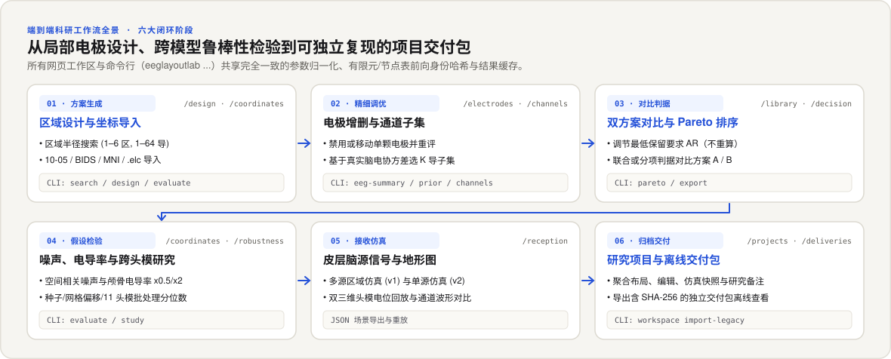
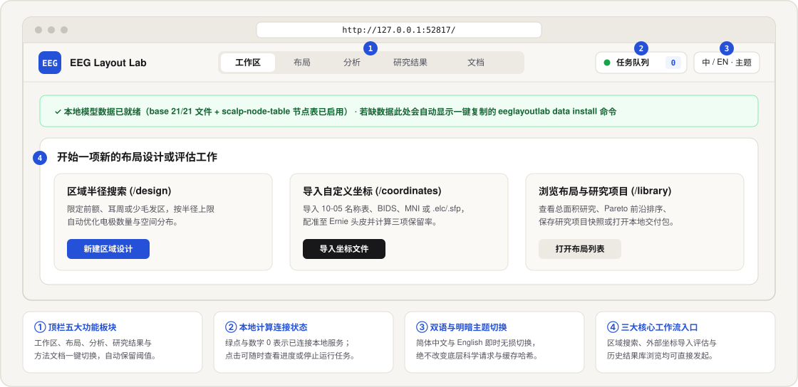
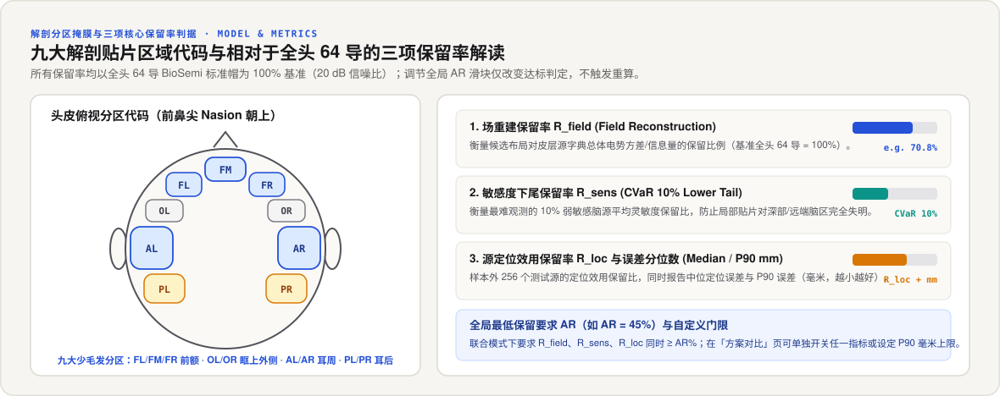
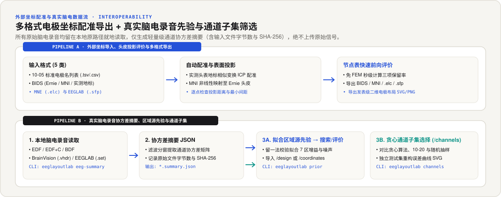

# 完整使用手册

本手册系统介绍 **EEGLayoutLab** 网页工作台与 `eeglayoutlab` 命令行的全部功能与操作方法，涵盖顶栏五大功能板块导航、三项核心保留率指标解读、局部区域布局优化设计、外部多格式电极坐标导入与单点编辑、双方案对比判据、跨噪声/颅骨电导率/11 个体头模的稳健性研究、皮层信号接收仿真、真实脑电录音先验拟合与通道子集筛选、研究项目与离线交付包归档，以及命令行批处理脚本示例。

[English User Manual](user-manual.md) · [完整安装手册](installation.zh-CN.md) · [快速上手简明页](getting-started.zh-CN.md) · [命令行参考（英文）](command-line.md) · [模型与指标定义（英文）](model-and-metrics.md)

## 1. 软件定位与端到端科研工作流

传统全头 64 导脑电帽覆盖整个头皮，而可穿戴脑机接口、睡眠监测、动态便携脑电以及前额/耳周（ear-EEG）贴片设备往往只能将电极布置在局部少毛发区域。EEGLayoutLab 在高保真有限元解剖头模（SimNIBS 标准被试 **Ernie** 及 11 个跨被试头模）上，以全头 64 导 BioSemi 标准布局（`standard64`）为统一基准，定量回答「局部或减导方案保留了多少有效脑源信息、在最弱脑区与源定位精度上付出了多大代价」。



网页端与命令行共享**完全同一套参数归一化、前向模型哈希身份与本地结果缓存**，完整闭环分为六个阶段：

1. **方案生成与坐标导入（`/design`、`/coordinates`）**：按解剖区域与贴片半径上限自动搜索局部布局（支持 `1、2、3、4、6` 个区域、`8、12、16、24、32、48、64` 七档电极数及均分/跨区自适应配额），或直接导入 10-05 名称表、BIDS、MNI、实测头表地标、`.elc`、`.sfp` 坐标。
2. **精细调优与通道子集（`/electrodes`、`/channels`）**：在已有布局上禁用故障/冗余电极或微调位置并重新评分；或直接从真实脑电录音协方差矩阵中筛选最优 `K` 导子集。
3. **对比判据与前沿排序（`/library`、`/decision`）**：在布局列表中按多目标 Pareto 支配关系排序，实时拖动**最低保留要求（`AR`）**滑块检视达标情况，并对方案 A 与方案 B 执行并排定量对比与报告导出。
4. **模型假设与稳健性检验（`/coordinates`、`/robustness`）**：检验布局在空间相关噪声、颅骨电导率减半/加倍（`skull_x0.5`、`skull_x2`）、电极脱落/接触阻抗不均/重复戴帽偏移，以及多随机种子、网格位移和 11 个体头模批量研究下的表现。
5. **皮层信号接收仿真（`/reception`）**：对区域分布式脑源（一代 `v1`）或皮层单偶极子源（二代 `v2`）进行时域波形与双三维头模头皮电位同步回放对比。
6. **项目归档与离线交付（`/projects`、`/deliveries`）**：将关键布局、编辑副本、信号实验、研究备注和判据组合成**研究项目**，一键导出附带 SHA-256 校验值的独立**项目交付包**，合作者在浏览器中即可离线完整复现查阅。

## 2. 界面导航、顶栏五大板块与本地会话机制

激活环境后运行 `eeglayoutlab quickstart`（或 `eeglayoutlab serve ~/eeglayoutlab-workspace`，安装细节见[完整安装手册](installation.zh-CN.md)）即可在浏览器打开应用。



### 顶栏五大功能板块速览

| 顶栏板块 | 包含子页面与路由 | 核心用途 |
| --- | --- | --- |
| **工作区（Workspace）** | 工作区首页（`/`）· 研究项目（`/projects`）· 交付包阅读器（`/deliveries`） | 查看模型数据就绪状态与最近记录、管理计算队列、整理研究项目快照、离线打开项目交付包 |
| **布局（Layout）** | 布局列表（`/library`）· 布局详情（`/layout`）· 区域设计（`/design`）· 坐标导入（`/coordinates`）· 电极编辑（`/electrodes`） | 检索筛选全部布局、旋转查看三维头模与坐标表、搜索局部区域新方案、导入外部坐标文件、增删移动单颗电极 |
| **分析（Analysis）** | 方案对比（`/decision`）· 稳健性研究（`/robustness`）· 信号仿真（`/reception`）· 通道子集（`/channels`） | 双方案并排达标判定与报告下载、多案例稳健性批处理、时域脑电信号与三维电位回放、真实脑电通道子集优选 |
| **研究结果（Findings）** | 总面积研究（`/findings`）· 历史批次（`/results`、`/pilot-results`） | 交互式浏览内置的 30 组总面积预算研究（`strict_area`）及早期基准实验批次 |
| **文档（Documentation）** | 使用指南（`/guide`）· 建模与原理（`/method`）· 完整文档站（`/docs/`） | 查阅界面内置操作释义、数学公式摘要及完整方法学与参考文献章节 |

### 三个高频全局交互机制

- **最低保留要求（`AR`）滑块（零重算实时判据）**：`AR` 参数会随页面跳转自动保留在地址栏（`?ar=...`）。拖动 `AR` 滑块只会用新门槛重新评判**已保存的得分**并更新「达标 / 未达到要求」标签，**绝不会发起任何后台重算任务**。
- **中英双语与明暗主题即时切换**：右上角可随时在**简体中文**与 **English** 间切换。系统界面、解剖区域名称、后台计算进度与报错诊断、以及导出的对比报告都会同步切换语言，而底层 JSON 请求、数值精度与科学缓存键保持字节级不变。
- **任务队列与单槽串行保护**：右上角显示绿点与 `0` 代表已连接且当前空闲。同一安装根每次严格运行 **1 个**计算进程，避免多线程有限元或搜索任务争抢内存与 CPU；新提交的任务会自动排队（保存在 `<工作区>/.eeglayoutlab/queue.json`），点击队列面板可随时查看进度百分比或点击**停止计算**安全取消。

## 3. 头皮解剖分区代码、核心指标与达标判据

读懂九大头皮解剖区域代码与三项相对保留率指标，就能迅速把握所有图表、排行榜和对比报告的物理含义（完整数学推导见 [Model and metrics](model-and-metrics.md) 与 [Method details](method-details.md)）。



### 布置范围模式与九大预设区域代码

在 Ernie 可布置外头皮网格（共 `4,847` 个满足最小电极间距 `4 mm` 的候选顶点）上，区域设计支持三种空间范围约束：

- **全头自由选址（`whole_surface` / `whole_scalp_free`）**：允许算法在整个可布置头皮表面自动寻找最优贴片中心。
- **少毛发区域（`low_hair` / `low_hair_free`）**：将贴片约束在前额与双侧耳周少毛发带内，适合头环式、贴片式与耳周可穿戴设备。
- **预设解剖分区（`preset`）**：为每个贴片明确指定九大低毛发代理解剖掩膜之一：
  - `FL`、`FM`、`FR`：左、中、右前额区（Forehead）
  - `OL`、`OR`：左、右眶上外侧区（Superolateral Periorbital）
  - `AL`、`AR`：左、右扩展耳周区（Expanded Periauricular）
  - `PL`、`PR`：左、右近耳后区（Near-Postauricular）

### 核心评分指标含义（均以 20 dB 信噪比下全头 `standard64` 为 100% 基准）

| 界面指标名称 | JSON 字段名 | 物理与统计含义 |
| --- | --- | --- |
| **场重建保留率（`R_field`）** | `field_relative` | 候选布局在 `4,096` 个皮层字典源上保留的对数行列式信息量 / 电势空间可重构比例（`standard64 = 100%`） |
| **敏感度下尾保留率（`R_sens`）** | `sensitivity_tail` | 最难观测的 **10% 弱敏感皮层源（CVaR 下尾）**平均灵敏度保留比例，专门揭示局部贴片是否存在深部或远端脑区盲区 |
| **源定位效用保留率（`R_loc`）** | `localization_relative` | 在独立于搜索字典的 **`256` 个样本外测试源**上的源定位效用保留比例 |
| **中位 / P90 定位误差（`mm`）** | `median_mm`、`p90_mm` | 样本外偶极子点定位误差的中位数与 90% 分位数（单位毫米，**越小越好**，可直接与全头基准 `reference_median_mm` / `reference_p90_mm` 对照） |
| **总贴片覆盖面积（`cm²`）** | `union_area_cm2` | 所有启用贴片在头皮网格上的并集几何面积 |

**达标判定规则：** 在默认的**联合阈值（Joint `AR`）**模式下，当且仅当 `R_field >= AR%`、`R_sens >= AR%` 且 `R_loc >= AR%` 三项同时满足时判定为**达到要求**。进入**分析 → 方案对比（`/decision`）**后，可切换为**自定义要求（Custom）**，单独开启或关闭任意指标，或直接设定 `P90 <= 25 mm` 等毫米级定位误差上限。

## 4. 浏览研究结果、布局列表与三维头模详情页

### 研究结果（`研究结果 → 总面积研究`，`/findings`）

展示内置的 30 组固定总面积预算研究（`strict_area`：涵盖全头自由与少毛发两种范围、`40–240 cm²` 总面积上限及 `1–6` 个区域）。点击任意行右侧的**查看布局与指标**即可在侧边抽屉直接调出三维头模与详细得分，无需离开总表。

### 布局列表（`/library`）与布局详情页（`/layout`）

1. 打开**布局 → 布局列表（`/library`）**：
   - 可按**实验协议**（全部、本机半径搜索缓存 `cache`、总面积研究 `strict_area`、外部坐标评价 `design_evaluation`、电极编辑记录 `editor`）、**区域数量**、**电极数量**或关键词（如 `耳周`、`AL`、`前额` 或自定义方案名）组合筛选。
   - 在同一评价条件下可开启 **Pareto 前沿排序**，快速找出在场重建、敏感度下尾与源定位上不被任何其他方案全面压制的非支配解（Rank 1）。
2. 点击任意记录的**查看布局**进入**布局详情页（`/layout`）**：
   - **交互式三维头模画布**：鼠标拖拽旋转、滚轮缩放，可切换显示候选电极（按所属贴片分区着色）、半透明的全头 `standard64` 参照点位以及皮层感兴趣区（ROI）网格。
   - **同一组坐标的多条件评价聚合**：若同一组电极坐标先后在名义 Ernie 头模、空间相关噪声、颅骨电导率失配或其他个体头模下做过评价，详情页会将它们聚合在同一页面下（名义 Ernie 排第一），并提供一键跳转至**方案对比**、**电极编辑**、**信号仿真**或**创建稳健性研究**的操作入口。

## 5. 局部区域布局优化设计（`布局 → 区域设计`，`/design`）

当你需要为贴片式、头环式或耳周硬件寻找最优电极排布时，打开**布局 → 区域设计（`/design`）**：

1. **设定区域数量（`1、2、3、4、6` 区）、布置范围与通道配额**：选择**全头表面**、**少毛发区域**或**指定解剖分区**（例如双侧耳周选 `2` 区并指定 `AL` + `AR`；耳后加前额三贴片选 `3` 区并指定 `PL` + `PR` + `FM`），并可选择**各区均分（默认）**或**跨区自适应配额**（`R >= 2`，每区至少保留 4 颗锚点电极）。
2. **设定每区测地线半径上限（`15–80 mm`，步长 `5 mm`）、电极总数（`K`）与优化目标**：
   - 拖动**每区半径上限**（如 `20–45 mm`）控制单块贴片尺寸，并可选**下尾极小极大（默认）**或**子空间信息复合目标**。
   - 选择**电极总数**（支持 **`8、12、16、24、32、48、64`** 七档，默认 `64` 导）。在 `25–35 mm` 紧凑贴片约束下，`24` 或 `32` 导方案往往能避免电极过度拥挤，在样本外源定位保留率上追平甚至优于 64 导，同时减少一半采集通道。
3. **可选噪声模型或经验数据先验**：默认采用独立同分布通道噪声（`iid`），也可切换为空间相关噪声（`spatial_10`、`spatial_20`、`spatial_40`）、脑背景噪声（`brain_background`），或加载由真实脑电拟合的 `eeg-data-prior/1` 先验文件。
4. **命中缓存秒开或提交新搜索**：
   - 若当前参数组合在本机已有完全一致的已完成记录，主按钮会显示**读取已保存结果**，点击即可秒级加载而不重复计算。
   - 若为新配置，点击**开始搜索**即可提交后台收敛式 Fedorov 交换 + 混淆裕度重排计算，完成后自动写入本机布局库。
   - 带有 `?draft=1&...` 的页面链接可直接保存或发给同事复现参数草稿，打开链接本身不会偷偷触发后台计算。

## 6. 外部坐标导入评价与单颗电极微调



### 坐标导入（`布局 → 坐标导入`，`/coordinates`）

只需安装了默认的 `scalp-node-table` 节点表数据包（无需本机安装 SimNIBS），即可在几秒内评估任意外部脑电帽、CAD 贴片设计或实测数字化坐标（格式细节见[坐标文件接口说明（英文）](coordinate-file-interface.md)）：

1. **直接上传以下任意一种坐标文件**：
   - **10-05 标准电极名称列表（`.tsv` / `.csv` / `.txt`）**：64 个国际 10-05 标准导联名（旧称 `T3/T4/T5/T6` 会自动映射为 `T7/T8/P7/P8`），可带分区列，也可在命令行用 `--regions` 自动均衡分区。
   - **BIDS 坐标对（`*_electrodes.tsv` + `*_coordsystem.json`）**：支持 Ernie 原生毫米坐标系（`ernie_native_mm`）、MNI 标准模板空间（自动非线性映射至 Ernie 头皮），以及带鼻根/左右耳前点地标（`NAS` / `LPA` / `RPA`）的**被试实测数字化坐标**（通过最多 500 步相似变换 ICP 自动配准至 Ernie 头皮）。
   - **MNE-Python 导联文件（`.elc`）**或 **EEGLAB 导联文件（`.sfp`）**（支持声明 `mm`、`cm`、`m` 单位）。
   - **标准设计文件（`eeg-electrode-design/1` JSON）**、可导入布局 CSV 或完整可复现包。
2. **逐点核查头皮投影距离与电极名称**：
   - 系统会将输入点投影至 Ernie 外头皮可布置表面，并列出每颗电极的输入坐标、投影后坐标与投影距离（`mm`）。若某点偏离头皮超过 `10 mm` 或映射后最小电极间距低于阈值，界面会给出精确到第几号电极的中文诊断说明。
   - 导入的电极名称与坐标来源说明保存在当前工作区 `<工作区>/annotations/electrode-names/` 下，既能在三维头模和图表中完整显示导联名，又不会污染纯数值缓存哈希。
3. **选择评价与扰动选项**：支持常规评价（`evaluate`）与位置偏移扰动测试（`perturb`），可设定扰动半径（默认 `6 mm`）、随机种子（`42`）、噪声模型、颅骨电导率情景（`skull_x0.5` / `skull_x2`）及跨会次稳健性（`standard/1`：同时评估电极随机脱落、接触阻抗不均与重新戴帽偏移）。
4. **多格式标准导出**：评价前或评价后均可一键导出 Ernie 原生 BIDS、MNI BIDS、MNE `.elc`、EEGLAB `.sfp`、坐标 CSV、二维发表级布局图（SVG / PNG，可开关导联标签）或完整可复现 JSON 包。

### 电极编辑（`布局 → 电极编辑`，`/electrodes`）

想在某个已保存的 64 导布局上测试「去掉某几颗电极会掉多少分」或微调点位：

1. 在布局详情页点击**编辑电极**（或直接打开 `/electrodes` 选择父布局）。
2. 在电极列表中取消勾选任意通道（例如禁用 `E1` 变成 63 导，或裁剪为更少通道），或将某颗电极改派到贴片内的其他可布置顶点。
3. 点击**评价并另存此布局**。系统会完整保留原 64 导父布局不变，为修改后的新方案独立计算场重建、敏感度下尾与源定位指标并归档在父布局记录下。

## 7. 双方案并排对比与多案例稳健性研究

### 方案对比（`分析 → 方案对比`，`/decision`）

1. 在**选择对比方案**区分别选定**方案 A** 与**方案 B**。若某个布局在多种模型条件下做过评价，右侧条件选择器可精确选定要对比的那一次评价（例如对比名义条件与颅骨电导率加倍条件）。
2. 在判据栏选择**联合要求（Joint `AR`）**或**自定义要求（Custom）**（如只考核场重建 ≥ `68%`、敏感度 ≥ `30%` 且 `P90 <= 20 mm`）。
3. 页面即时生成达标结论、逐项差值与几何面积对比；点击**导出对比报告（Markdown）**即可下载结构化报告（内嵌字节级一致的原始请求与身份 JSON 代码块，可直接作为论文补充材料）。

### 稳健性批量研究（`分析 → 稳健性研究`，`/robustness`）

单次评价只反映单一随机种子或单一模板头。**稳健性研究**（详见[稳健性协议说明（英文）](robustness-studies.md)）用于对同一组 64 导坐标批量运行 `1–12` 个显式案例并汇总经验分位数：

1. 从**坐标导入 → 用此坐标创建稳健性研究**跳转，或直接在 `/robustness` 选择布局并新建研究。
2. 选择三类协议之一：
   - **`noise_seeds`（多随机种子）**：检验不同测试源/噪声随机抽样下的指标波动。
   - **`grid_displacements`（候选网格切向位移）**：模拟每次戴帽整体朝不同方向偏移数毫米时的性能退化。
   - **`heads`（跨个体头模解剖迁移）**：将布局映射至最多 11 个独立解剖头模（`ernie_xh` + 10 个 `ixi*` 被试头模，通过 `eeglayoutlab data install --examples` 安装）逐一评分。
3. 点击**保存草稿**后再点**开始计算**。每个已完成案例都会将原始缓存字节独立快照保存在 `<工作区>/studies/<id>/snapshots/` 中；若中途关闭终端停止了服务，下次打开页面点击**继续研究**即可断点续跑，已算完的案例直接秒级复用。
4. 全部案例完成后，页面自动按 Type-7 分位数汇总展示**中位数（Median）**、**P10（最差 10% 下界）**与 **P90**，并清晰单列因极端偏移超出头皮几何限制而未予评分的案例数。

## 8. 皮层信号接收仿真（`分析 → 信号仿真`，`/reception`）

信号仿真工作区让你直观看到「同一脑源活动在全头 64 导标准帽与你的紧凑布局上分别长什么样」：

1. **选择兼容的 64 导布局**：信号仿真仅接受默认独立噪声协议下的 64 导布局。*（若某布局是在空间相关噪声或自定义经验先验下专门寻优得到的，详情页与项目页会明确提示协议边界而不提供信号仿真跳转，避免不同噪声假设被静默混用。）*
2. **选择脑源仿真模式**：
   - **多源区域仿真（一代 `v1`）**：所有安装方式（含 Conda 版，仅需 `base` 数据包）均原生支持。可选择目标脑区（额叶、颞叶、顶叶、枕叶等）、信号波形（突发波包 `burst`、持续振荡 `oscillation`、事件相关电位 `erp`）与伪迹强度。
   - **单源皮层偶极子仿真（二代 `v2`，`dk40-six-roi-v1`）**：从冻结测试源中选择单个皮层偶极子（如 `source=2`）进行高精度前向仿真。*新提交*二代仿真计算需要含 SimNIBS 的源码环境；已保存的二代仿真记录与交付包在任何环境中均可直接打开回放。
3. **双三维头模电位动画与单导波形对比**：
   - 点击**播放时间标记**（或拖动**波形观察时间**滑块），左右两颗三维头模（左侧全头 64 导参照、右侧候选布局）会实时同步渲染头皮电位地形分布。
   - 使用两个**查看电极**下拉框切换任意通道对拍时域波形，点击**导出本场景 JSON** 可下载包含完整 64 导坐标、请求参数与多通道波形数组的原始数据。

## 9. 结合真实采集脑电：经验源先验与通道子集筛选

如果你手头已有实验采集的真实脑电录音（支持 `EDF` / `EDF+C`、`BDF`、BrainVision `.vhdr` 及 EEGLAB `.set`），可以在**原始录音文件完全不离开原路径、不上传任何时间序列**的前提下，用真实数据指导布局设计与减导筛选：

### 第一步：就地提取频带通道协方差摘要（`eeg-summary`）

```sh
eeglayoutlab eeg-summary /path/to/recordings/*.edf \
  --band 1,40 --epoch 2 --label "task-eeg" \
  --out-dir ./summaries
```

工具就地只读扫描原始文件，输出轻量的 `<文件名>.summary.json`（`eeg-covariance-summary/1`），内含频带协方差矩阵及原始录音每个组成部分（如 `.vhdr`/`.eeg` 或 `.set`/`.fdt`）的字节数与 SHA-256 校验值。

### 第二步 A：拟合七脑区经验源先验（`prior`）用于布局搜索或评价

```sh
eeglayoutlab prior ./summaries --out ./empirical-prior.json
```

命令行会自动完成 7 个皮层分区增益与传感器噪声参数的拟合并打印留一法交叉验证结果。随后在网页端**区域设计（`/design`）**或**坐标导入（`/coordinates`）**加载 `empirical-prior.json`（或在命令行传入 `--data-prior ./empirical-prior.json`），即可针对你的真实实验脑电分布定制布局。

### 第二步 B：筛选最优 `K` 导通道子集（`分析 → 通道子集` 或 `channels`）

在浏览器打开**分析 → 通道子集（`/channels`）**直接拖入 `.summary.json` 文件（亦可直接点击**载入示例协方差摘要**一键体验内置 32 导 10-05 合成数据，全程在浏览器本地内存计算），或在命令行指定独立测试集并直接导出误差对比曲线 SVG：

```sh
eeglayoutlab channels ./train-summaries \
  --test ./test-summaries \
  --prior ./empirical-prior.json \
  --counts 8,16,24,32 \
  --draws 200 --seed 1 \
  --out ./subset-report.json \
  --figure ./subset-curve.svg
```

系统会在每个目标通道数 `K` 下同步对比**贪心重构子集（Greedy）**、**国际 10-20 标准子集**与 **`200` 次随机抽样子集**在训练集及独立留出测试集上的重构误差。

## 10. 研究项目管理与可复现离线交付包（`/projects` 与 `/deliveries`）

当一项课题产生多组候选贴片、减导编辑副本与信号实验时，使用**工作区 → 研究项目（`/projects`）**进行论文级归档：

1. **新建工作区项目**：填写项目标题与负责人备注（纯本地保存在 `<工作区>/projects/<uuid>/` 下，无需设置任何访问密钥或账号）。
2. **保存不可变实验快照**：在布局页、电极编辑页或信号仿真页将关键结果加入项目，编写研究结论备注，并锁定参照方案、候选方案及 `AR` 判据。每个项目条目都会独立拷贝并校验底层科学 JSON 快照，即使日后清理了任务队列也不会失效。
3. **下载项目交付包**：在项目页点击**下载项目交付包**，生成单个自包含 `.json` 文件（`research-project-delivery/1`），内含全部实验快照字节、SHA-256 校验清单、可读摘要报告、对比判据及模型/运行环境身份记录（大型头模文件通过清单哈希引用，保持交付包轻便）。
4. **随时随地离线审阅（`/deliveries`）**：将交付包发给导师、合作者或审稿人后，对方只需在本机应用的 `/deliveries` 页面（甚至直接打开零安装的在线展示站 `eeglayout.org/deliveries`）选择该 JSON 文件，即可在浏览器中完整查看三维头模、各项保留率得分与仿真波形，完全不依赖你的原始工作区。

*（如需迁移早期旧版 Node 服务保存在 `results/web-service` 中的项目与研究，先停止旧服务，再执行 `eeglayoutlab workspace import-legacy ~/eeglayoutlab-workspace --dry-run` 预览，确认无误后去掉 `--dry-run` 即可逐字节无损导入。）*

## 11. 命令行全功能速查与自动化脚本示例

全部 14 个子命令均由纯 Python 驱动，无需浏览器或 Node.js（源码开发版请在命令前加 `.venv/bin/`，完整参数见 [Command line](command-line.md)）：

| 子命令 | 功能说明 | 常用调用示例 |
| --- | --- | --- |
| `quickstart` | 自动补齐默认数据包并启动浏览器工作区 | `eeglayoutlab quickstart ~/eeglayoutlab-workspace` |
| `doctor` | 检查环境与数据健康度（加 `--smoke` 跑真实计算校验） | `eeglayoutlab doctor --smoke` |
| `serve` | 启动本地网页服务（支持 `--no-browser`、`--cache-only`） | `eeglayoutlab serve ~/my-workspace --no-browser` |
| `data` | 管理模型数据包（`list`、`install`、`verify`、`compose`、`remove`） | `eeglayoutlab data install scalp-node-table` |
| `design` | 将 10-05、BIDS（原生/MNI/实测地标）、`.elc`、`.sfp`、CSV 或 64 导均分搜索结果转为 `DESIGN.json` | `eeglayoutlab design cap64.elc --regions 4 --out cap64.json` |
| `export` | 将 `DESIGN.json` 或任意 `8–64` 导搜索 `.result.json` 导出为 `bids`、`mni`、`mne`（`.elc`）、`eeglab`（`.sfp`）或二维 `svg` | `eeglayoutlab export search.result.json --format svg --out-dir figs/` |
| `search` | 通过请求 JSON 或内联 `--regions`/`--radius`/`--mode` 参数运行区域半径搜索 | `eeglayoutlab search --regions 2 --radius 30 --mode preset --masks AL,AR --electrodes 24 --out-dir runs/` |
| `evaluate` | 评估或扰动测试 `DESIGN.json` / 请求 JSON | `eeglayoutlab evaluate --design cap64.json --radius 6 --seed 42 --out-dir runs/` |
| `study` | 批量运行 `noise_seeds`、`grid_displacements` 或 `heads` 稳健性研究 | `eeglayoutlab study cross_head_study.json --out-dir study_out/` |
| `pareto` | 对同条件下的多个 `.result.json` 计算多目标 Pareto 等级并打印 TSV 表 | `eeglayoutlab pareto runs/*.result.json --out pareto.json` |
| `eeg-summary` | 就地读取原始脑电录音并生成频带通道协方差摘要 | `eeglayoutlab eeg-summary sub-*.vhdr --band 8,13 --out-dir cov/` |
| `prior` | 从协方差摘要拟合 7 脑区源增益与噪声先验 | `eeglayoutlab prior cov/ --out alpha-prior.json` |
| `channels` | 对比贪心、10-20 与随机 `K` 导子集重构误差并输出 SVG 曲线 | `eeglayoutlab channels cov/ --counts 8,16,32 --out sub.json --figure sub.svg` |
| `examples run` | 运行内置三大可复现示例并与 `examples/expected.json` 在 `1e-6` 内比对 | `eeglayoutlab examples run --skip-cross-head` |

### 端到端批处理示例：从 10-05 导联表生成设计、评估稳健性并导出 MNE 与矢量图

```sh
# 1. 从 64 导 10-05 导联名称表生成标准设计 JSON
eeglayoutlab design examples/01-standard64/standard64-labels.tsv \
  --name "standard64" --out /tmp/standard64.json

# 2. 计算名义 Ernie 得分并附带跨会次稳健性（电极脱落、接触阻抗不均、重复戴帽偏移）
eeglayoutlab evaluate --design /tmp/standard64.json \
  --radius 6 --seed 42 --robustness standard/1 --out-dir /tmp/eval-out

# 3. 导出 MNE (.elc)、MNI BIDS 坐标对以及带电极标签的发表级二维头皮布局 SVG
eeglayoutlab export /tmp/standard64.json --format mne --out-dir /tmp/exports
eeglayoutlab export /tmp/standard64.json --format mni --out-dir /tmp/exports/mni
eeglayoutlab export /tmp/standard64.json --format svg --labels yes --out-dir /tmp/exports
```

## 12. 常见问题解答（FAQ）

- **为什么同一请求在 Mac 和 Linux 上算出的数值几乎完全一致，但缓存键（`job.key`）不同？**
  科学缓存键会故意将当前机器的计算解释器路径与底层数值库元数据（`numpy`、`scipy`、`cortech`、`numba`）纳入哈希，防止不同平台或不同库版本的缓存被静默混用。跨机器对比复现结果时请直接对比**数值指标**（macOS arm64 与 Linux x86_64 实测最大浮点差仅约 `4e-14`，`examples run` 按 `1e-6` 严格核验），无需对比 `key` 字符串。
- **为什么拖动 `AR` 最低保留要求滑块不会产生新计算任务？**
  `AR` 是作用在已保存保留率（`R_field`、`R_sens`、`R_loc`）之上的合格线判据，因此可以在不同应用场景要求间零延迟自由切换。
- **为什么在空间相关噪声或数据先验下搜索出的布局没有「进入信号仿真」按钮？**
  信号仿真工作区采用默认独立噪声协议合成通道噪声；为避免把非默认噪声假设下寻优的布局静默放进另一套噪声模型中仿真，系统会在卡片上明确说明协议边界并隐藏跳转按钮。
- **软件代码和导出的图表/数据可以用于论文发表或商业研发吗？**
  本项目原创源代码与文档采用 [GPL-3.0-only](../LICENSE) 开源许可（允许商业使用，修改再分发须遵守 GPL）。但需注意：**Ernie 头部解剖网格、MNI 映射及派生显示/模型数据**源自 SimNIBS v4.1 示例数据集，继续适用 **CC BY-NC 4.0**（仅限非商业科研与教学使用，须保留署名；详见 [THIRD_PARTY_NOTICES.md](../THIRD_PARTY_NOTICES.md) 与 [`CITATION.cff`](../CITATION.cff)）。
